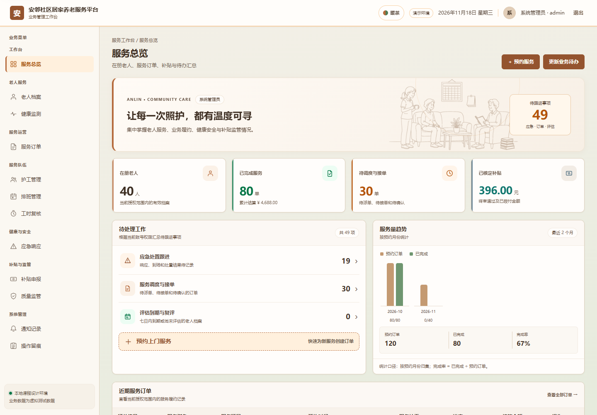
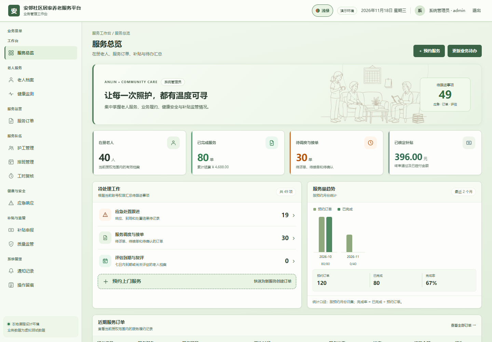

# 2026-11-17 最终版变更总览

> 对比基线：`3663cc8`（`Initial commit: 社区居家养老服务平台`）
> 最终版内容：本地数据库/后端复核修复 17 组 + 组内五项逻辑/后端七项修复 + 界面改版 + 操作留痕噪声修复
> 验证结果：`pytest` **121 passed**；12 个业务页面加载正常，0 个 JavaScript 错误，390×844 无横向溢出
> 本地预览：`http://127.0.0.1:5001`，管理员 `admin / Care2026!`


## 1. 一句话结论

最终版把三条工作线合并到同一棵树：本地 2026-11-17 的数据库/后端复核修复（F01—F17）、组内的五项逻辑与后端七项修复、界面改版与操作留痕优化。数据库对象为 **33 表 / 276 列 / 17 视图 / 11 过程 / 16 触发器 / 3 函数**，测试由 64 项增至 **121 项全通过**（本地 65 + 组内 56）。

## 2. 工作线

| 时间 | 工作 | 结果 | 证据 |
| --- | --- | --- | --- |
| 11-17 13:23 | 复核 10 个 SQL 文件、业务分析与数据字典 | 形成问题清单；发现证书 NULL、冻结清单缺口、阈值跨社区、DELETE 权限过大等 | `docs/management/修复记录_20261117.md` |
| 11-17 15:19–16:05 | 修复 F01—F17，并在 SQL Server 实跑 | 65 passed；对象数 33/276/17/11/15/3 | `docs/evidence/pytest-results.xml` |
| 11-17 16:01–17:15 | 界面去模板化、导航图标、登录页、审计中文化 | 浅暖顶栏、分组侧栏、密集表格、中文审计标签 | `docs/management/界面改版记录_20261117.md` |
| 11-17 17:15–19:50 | 审计噪声定位与修复；暖茶陶土棕配色；v2 Dashboard | 空转 tick 不再写审计；页面改为暖灰/茶棕 | `docs/management/审计噪声修复_20261117.md` |
| 11-17 20:00–20:26 | 7 组导航重排、快捷预约、hero 文案、最终截图 | 12 页浏览器检查通过；9 张前后对照图 | `docs/management/界面改版与操作留痕说明_20261117.md` |
| 11-17 20:40–21:10 | 审查并合并组内五项逻辑/后端七项修复 | 56 项组内回归通过；合计 121 passed | 本文第 4 节、`tests/test_five_logic_fixes.py`、`tests/test_backend_fixes.py` |

## 3. 本地数据库与后端 17 组修复

完整过程、失败回退和探针记录见 [修复记录_20261117.md](修复记录_20261117.md)；这里给出可核对的清单。

| 编号 | 问题 | 最终处理 |
| --- | --- | --- |
| F01 | 空 `.venv` 让 `start.ps1` 直接 `ModuleNotFoundError` | 逐个候选解释器执行 `import flask, pyodbc`，失败自动回退 |
| F02 | `requirements.txt` 旧 pin 与实际环境不一致 | 固定 Flask 3.1.2 / Werkzeug 3.1.3 / pyodbc 5.5.0 / cryptography 50.0.2 / pytest 9.2.0 |
| F03 | `service_item` 证书 CHECK 的 NULL 漏洞 | 命名约束 `CK_service_item_certificate_pair`，补 `certificate_level IS NOT NULL` 与 1—3 范围 |
| F04 | 缺派单与订单查询索引 | 新增 `IX_assignment_shift`、`IX_order_elderly_item_date` |
| F05 | `v_vital_history` 用阈值配置社区当归属社区 | 改为 `elderly.community_id` |
| F06 | `sp_review_hours` 无事务、无行锁 | 加 `XACT_ABORT`、事务与 `UPDLOCK,HOLDLOCK` |
| F07 | `sp_finish_order` 审计没有操作人 | 增加可选 `@actor_id`，应用两处调用传当前用户 |
| F08 | `sp_publish_shift` 起止颠倒时错误不友好 | 进事务前判断并 `THROW 51024` |
| F09 | `sp_pay_claim` 未校验账号启用、凭证未 TRIM | 补 `u.active=1` 与 `LTRIM(RTRIM(@reference))` |
| F10 | 退回申报只改状态，不重算金额和明细 | 退回时删 `claim_item`、重跑可申报集、更新金额与提交信息 |
| F11 | 已完成订单冻结清单漏字段、完成时可不写结算/时间 | 补比较列；完成必须同时有 `settlement` 与 `completed_at` |
| F12 | 终审/拨付后 `submitted_*`、`paid_*` 可改 | 补比较列；`paid_*` 仅在原状态为 paid 时冻结 |
| F13 | 体征阈值可跨社区使用 | 触发器校验 `rule.community_id = elderly.community_id`（51120） |
| F14 | 订单抽查不校验“服务已完成” | 新增 `tr_quality_order_completed`（51121） |
| F15 | `care_app` 拥有全库 DELETE | 收回 schema 级 DELETE，仅保留 `shift` 删除入口 |
| F16 | 37/33、16/17、11/14 口径散落 | 新增对象映射，统一业务分析、任务对照、README、数据字典 |
| F17 | 派单未检查岗前培训 | `fn_candidates` 增加 `trained_on` 非空且不晚于服务日 |

## 4. 组内五项逻辑/后端七项

组内这条线最初在 `3663cc8` 中，文档与测试都齐全，但原说明标注“未连接数据库、未运行集成测试、未执行迁移”。本次逐项审查后，采用其更完整的业务规则，同时保留本地更强的 F13/F11/F12 约束；冲突处按“更严格、可回归”的原则处理。

### 4.1 五项逻辑

| 问题 | 采用的处理 | 与本地修复的关系 |
| --- | --- | --- |
| 补录旧评估误暂停计划 | `elders.assess` 不再按本次插入等级暂停；`sp_expire_services` 统一取当天及以前最新评估，判断过期或等级与服务包不匹配；评估前锁老人 | 采用组内实现，替换本地按本次等级暂停的分支 |
| 修改服务记录沿用旧确认 | `tr_assignment_slots` 新增 51120/51121/51122：确认人与时间同填同清、服务记录变更须清空确认、确认人须为老人本人或有效授权家属；服务记录比较改为二进制 | 采用组内触发器，保留本地 F11 已完成订单冻结清单 |
| 证书类型非空而等级为空 | 命名约束 `CK_service_item_certificate_pair`；迁移预检 51201，发现存量不合法记录先列出再中止 | 采用组内迁移方式，与本地 F03 语义一致 |
| 迁移后重复体征 | `tr_vital_identity`（51123）按设备、采集时间、指标判重；`health.upload` 先按业务身份查历史，重传保留原绑定/规则/接收时间；新采集才取当前社区规则 | 采用组内实现；保留本地 F13 跨社区阈值 51120，验证 51123 的测试临时关闭 F13 |
| 质量抽查跨辖区 | 列表和录入统一：订单目标按订单历史社区，直接护工目标按护工服务区域；新增 `check_worker_area` | 采用组内实现，替换本地“逐社区 check”的过严写法 |

### 4.2 后端七项

| 编号 | 问题 | 采用的处理 |
| --- | --- | --- |
| BE01 | 异常恢复不能签退 | `resolve(resume)` 读取当前派单工时：未签退回到 `serving`，已签退回到 `confirming`；缺工时记录要求先核实 |
| BE02 | 终止服务阻止下一单 | 签到前的未签退检查排除 `terminated/cancelled` 订单；未结束异常仍阻断 |
| BE03 | 更新标签重置坐标 | `elders.update` 先锁档案；未提交经纬度时保留原值，不因迁移社区改地址而重置 |
| BE04 | 体征重传精度 | `Decimal` 四舍五入两位小数，非数字/无穷/超范围返回业务错误；重传比较使用同一精度 |
| BE05 | 反馈互相覆盖 | `feedback` 先锁订单；未提交字段保留，空白表示不修改，显式 `null` 才清空；投诉变更时清空旧处理结论 |
| BE06 | 直接护工抽查权限 | 街道/民政直接抽查按“至少一个服务社区在辖区”判断；订单目标仍按订单历史社区 |
| BE07 | 迁移后申报重交 | `sp_claim_month` 首次申报看老人当前社区，已有申报看首次申报社区；原社区可补材料，迁入社区不能接管；51025 映射 HTTP 403 |

## 5. 界面改版

界面部分详见 [界面改版与操作留痕说明_20261117.md](界面改版与操作留痕说明_20261117.md)，核心变化：

- 登录页改为浅暖米杏渐变系统条 + 照护场景插画 + 白色登录卡，演示账号折叠。
- 顶栏改为 64px 浅暖渐变全宽；侧栏 240px，按工作台 / 老人服务 / 服务运营 / 服务队伍 / 健康与安全 / 补贴与监管 / 系统管理 七组渲染。
- 总览改为暖色 Hero + 右侧线稿 + 4 项 KPI 横条 + 待办/趋势双栏 + 近期订单；待办区增加“预约上门服务”快捷按钮。
- 12 个业务页面统一密集表格、小方角状态标签、三列详情、两列表单。
- 操作留痕的业务对象与操作类型中文化，按语义着色；历史 `scheduler / tick` 行过滤，维护任务空转不再写审计。
- 390×844 下 `scrollWidth = 390`，无整体横向溢出。

### 5.1 暖茶 / 浅绿双配色

顶栏和登录页各有一个单键切换，默认暖茶，点击切到浅绿；选择保存在 `localStorage`，刷新后保持。浅绿版只替换色彩令牌，布局、字号、间距、圆角、图标和交互不变，两版视觉结构一致。

| 暖茶 | 浅绿 |
|:---:|:---:|
|  |  |

| 初版工作台 | 最终版工作台 |
|:---:|:---:|
|  |  |

| 初版登录 | 最终版登录 |
|:---:|:---:|
|  |  |

## 6. 关键统计

| 项目 | 数值 |
| --- | --- |
| 物理表 | 33 |
| 字段 | 276 |
| 视图 | 17 |
| 存储过程 | 11 |
| 触发器 | 16（新增 `tr_vital_identity`、`tr_quality_order_completed`） |
| 函数 | 3 |
| CHECK / FK / UNIQUE | 82 / 70 / 18 |
| 索引 | 17（11 普通 + 6 过滤唯一） |
| SQL 双实现 | 15 组 × 2 |
| 配色 | 暖茶 / 浅绿双主题，单键切换、localStorage 记忆 |
| 测试 | 121 passed（本地 65 + 组内 56） |
| 浏览器检查 | 12 页，0 JS 错误，390×844 通过 |

## 7. Git 变更

最终版相对 `3663cc8` 的主要文件类别：

- **数据库**：`sql/01_schema.sql`、`02_views.sql`、`03_procedures.sql`、`04_triggers.sql`、`05_security.sql`、`sql/queries/*.sql`、`sql/migrations/20261117_five_logic_fixes.sql`
- **后端**：`care/app.py`、`care/queries.py`、`care/security.py`、`care/services/*`
- **脚本**：`scripts/manage.py`、`scripts/verify_ui.py`、`scripts/maintenance.py`、`start.ps1`
- **前端**：`care/templates/index.html`、`care/static/style.css`、`care/static/app.js`、`care/static/optimization.html`、`care/static/login-illustration.png`、`care/static/hero-line-art.png`
- **测试**：`tests/test_database.py`（F13 回归）、`tests/test_five_logic_fixes.py`、`tests/test_backend_fixes.py`
- **文档与证据**：`docs/management/*`、`docs/design/*`、`docs/evidence/*`、`README.md`

具体差异以 `git log` 和 `git diff 3663cc8..HEAD` 为准；本文件不重复逐行 diff。

## 8. 复现与验证

```powershell
# 1. 依赖
.\.venv\Scripts\python.exe -m pip install -r requirements.txt

# 2. 全量测试（独立测试库，不写演示库）
.\.venv\Scripts\python.exe -m pytest tests -q

# 3. 启动
.\start.ps1
```

2026-11-17 最终复跑：`121 passed in 44.58s`（最终树，venv Python 3.11.9）。

浏览器检查记录见 `docs/evidence/browser-check.json`；最终截图见 `docs/evidence/screenshots/redesign/`。

## 9. 迁移与兼容

- `scripts/manage.py migrate` 现在先跑 `sql/migrations/20261117_five_logic_fixes.sql` 的存量预检，再更新 02—05；全部成功才统一提交，任一步失败整体回滚。
- 预检发现“证书类型/等级不匹配”或“同设备、采集时间、指标重复”时，会先列出记录，再分别以 51201/51202 中止，不自动改值、删行或合并。
- 本地 F13 的跨社区阈值校验（51120）比组内实现更严格，最终版保留；`tr_vital_identity` 作为数据库层防御，正常路径下由 F13 先拦截跨社区规则，测试在验证 51123 时临时关闭 F13。
- 本地 F11/F12 的冻结清单比组内版本更完整，最终版保留；组内 51122/51121/51120 确认触发器与本地冻结触发器合并。

## 10. 交付口径

- 物理表 **33**、字段 **276**、视图 **17**、存储过程 **11**、触发器 **16**、函数 **3**。
- 测试 **121 项全通过**（本地 65 + 组内 56）。
- 报告里不要写“34 列字段缺口已补”；该部分仍是下一轮方案，物理字段以数据字典为准。
- 组员分工表仍留空，由小组确认后填写。
