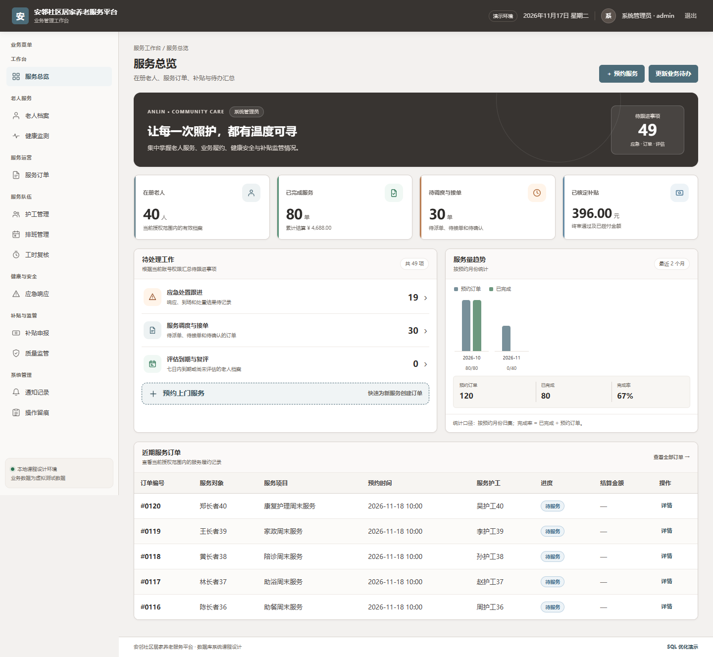
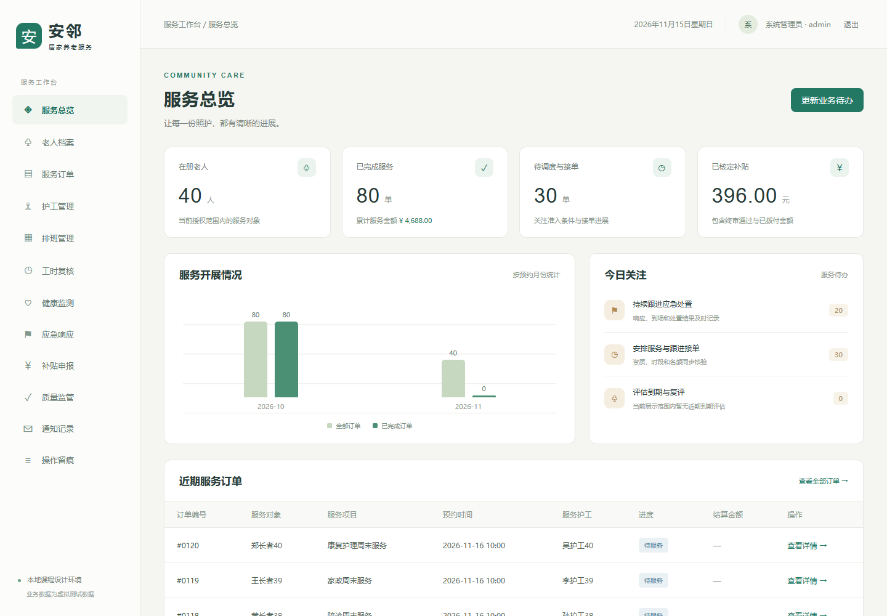
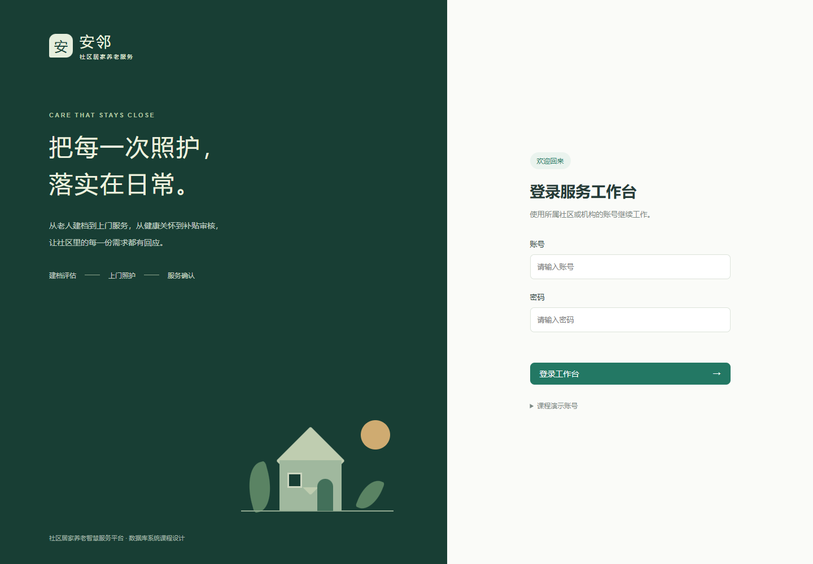

# 2026-11-17 最终版变更总览

> 对比基线：`3663cc8`（`Initial commit: 社区居家养老服务平台`）
> 最终版内容：数据库/后端复核修复 17 组 + 界面改版 + 操作留痕噪声修复
> 验证结果：`pytest` **65 passed**；12 个业务页面加载正常，0 个 JavaScript 错误，390×844 无横向溢出
> 本地预览：`http://127.0.0.1:5001`，管理员 `admin / Care2026!`



## 1. 一句话结论

最终版把两条工作线合并到同一棵树：一条是 2026-11-17 的数据库/后端复核修复（F01—F17），一条是界面改版与操作留痕优化。数据库对象为 **33 表 / 276 列 / 17 视图 / 11 过程 / 15 触发器 / 3 函数**，测试由 64 项增至 **65 项全通过**。

## 2. 两天的工作线

| 时间 | 工作 | 结果 | 证据 |
| --- | --- | --- | --- |
| 11-17 13:23 | 复核 10 个 SQL 文件、业务分析与数据字典 | 形成问题清单；发现证书 NULL、冻结清单缺口、阈值跨社区、DELETE 权限过大等 | `docs/management/修复记录_20261117.md` |
| 11-17 15:19–16:05 | 修复 F01—F17，并在 SQL Server 实跑 | 65 passed；对象数 33/276/17/11/15/3 | `docs/evidence/pytest-results.xml` |
| 11-17 16:01–17:15 | 界面去模板化、导航图标、登录页、审计中文化 | 深色顶栏、分组侧栏、密集表格、中文审计标签 | `docs/management/界面改版记录_20261117.md` |
| 11-17 17:15–19:50 | 审计噪声定位与修复；暖调陶土蓝配色；v2 Dashboard | 空转 tick 不再写审计；页面改为暖灰/陶土蓝 | `docs/management/审计噪声修复_20261117.md` |
| 11-17 20:00–20:26 | 7 组导航重排、快捷预约、hero 文案、最终截图 | 12 页浏览器检查通过；9 张前后对照图 | 本文与 `docs/management/界面改版与操作留痕说明_20261117.md` |

## 3. 数据库与后端 17 组修复

完整过程、失败回退和探针记录见 [修复记录_20261117.md](修复记录_20261117.md)；这里给出可核对的清单。

| 编号 | 问题 | 最终处理 |
| --- | --- | --- |
| F01 | 空 `.venv` 让 `start.ps1` 直接 `ModuleNotFoundError` | 逐个候选解释器执行 `import flask, pyodbc`，失败自动回退 |
| F02 | `requirements.txt` 旧 pin 与实际环境不一致 | 固定 Flask 3.1.2 / Werkzeug 3.1.3 / pyodbc 5.5.0 / cryptography 50.0.2 / pytest 9.2.0 |
| F03 | `service_item` 证书 CHECK 的 NULL 漏洞 | 命名约束并补 `certificate_level IS NOT NULL` 与 1—3 范围 |
| F04 | 缺派单与订单查询索引 | 新增 `IX_assignment_shift`、`IX_order_elderly_item_date` |
| F05 | `v_vital_history` 用阈值配置社区当归属社区 | 改为 `elderly.community_id` |
| F06 | `sp_review_hours` 无事务、无行锁 | 加 `XACT_ABORT`、事务与 `UPDLOCK,HOLDLOCK` |
| F07 | `sp_finish_order` 审计没有操作人 | 增加可选 `@actor_id`，应用两处调用传当前用户 |
| F08 | `sp_publish_shift` 起止颠倒时错误不友好 | 进事务前判断并 `THROW 51024` |
| F09 | `sp_pay_claim` 未校验账号启用、凭证未 TRIM | 补 `u.active=1` 与 `LTRIM(RTRIM(@reference))` |
| F10 | 退回申报只改状态，不重算金额和明细 | 退回时删 `claim_item`、重跑可申报集、更新金额与提交信息 |
| F11 | 已完成订单冻结清单漏字段、完成时可不写结算/时间 | 补比较列；完成必须同时有 `settlement` 与 `completed_at` |
| F12 | 终审/拨付后 `submitted_*`、`paid_*` 可改 | 补比较列；`paid_*` 仅在原状态为 paid 时冻结 |
| F13 | 体征阈值可跨社区使用 | 触发器校验 `rule.community_id = elderly.community_id`（51120） |
| F14 | 订单抽查不校验“服务已完成” | 新增 `tr_quality_order_completed`（51121） |
| F15 | `care_app` 拥有全库 DELETE | 收回 schema 级 DELETE，仅保留 `shift` 删除入口 |
| F16 | 37/33、16/17、11/14 口径散落 | 新增对象映射，统一业务分析、任务对照、README、数据字典 |
| F17 | 派单未检查岗前培训 | `fn_candidates` 增加 `trained_on` 非空且不晚于服务日 |

## 4. 界面改版

界面部分详见 [界面改版与操作留痕说明_20261117.md](界面改版与操作留痕说明_20261117.md)，核心变化：

- 登录页改为深色系统条 + 照护场景插画 + 白色登录卡，演示账号折叠。
- 顶栏改为 64px 深色全宽；侧栏 240px，按工作台 / 老人服务 / 服务运营 / 服务队伍 / 健康与安全 / 补贴与监管 / 系统管理 七组渲染。
- 总览改为 Hero + 4 项 KPI 横条 + 待办/趋势双栏 + 近期订单；待办区增加“预约上门服务”快捷按钮。
- 12 个业务页面统一密集表格、小方角状态标签、三列详情、两列表单。
- 操作留痕的业务对象与操作类型中文化，按语义着色；历史 `scheduler / tick` 行过滤，维护任务空转不再写审计。
- 390×844 下 `scrollWidth = 390`，无整体横向溢出。

| 初版工作台 | 最终版工作台 |
|:---:|:---:|
|  |  |

| 初版登录 | 最终版登录 |
|:---:|:---:|
|  |  |

## 5. 关键统计

| 项目 | 数值 |
| --- | --- |
| 物理表 | 33 |
| 字段 | 276 |
| 视图 | 17 |
| 存储过程 | 11 |
| 触发器 | 15（新增 `tr_quality_order_completed`） |
| 函数 | 3 |
| CHECK / FK / UNIQUE | 82 / 70 / 18 |
| 索引 | 17（11 普通 + 6 过滤唯一） |
| SQL 双实现 | 15 组 × 2 |
| 测试 | 65 passed（2026-11-17，venv Python 3.11.9） |
| 浏览器检查 | 12 页，0 JS 错误，390×844 通过 |

## 6. Git 变更

最终版相对 `3663cc8` 的主要文件类别：

- **数据库**：`sql/01_schema.sql`、`02_views.sql`、`03_procedures.sql`、`04_triggers.sql`、`05_security.sql`、`sql/queries/*.sql`
- **后端**：`care/app.py`、`care/queries.py`、`care/security.py`、`care/services/*`
- **脚本**：`scripts/manage.py`、`scripts/verify_ui.py`、`scripts/maintenance.py`、`start.ps1`
- **前端**：`care/templates/index.html`、`care/static/style.css`、`care/static/app.js`、`care/static/login-illustration.png`
- **测试**：`tests/test_database.py`（F13 回归）
- **文档与证据**：`docs/management/*`、`docs/design/*`、`docs/evidence/*`、`README.md`

具体差异以 `git log` 和 `git diff 3663cc8..HEAD` 为准；本文件不重复逐行 diff。

## 7. 复现与验证

```powershell
# 1. 依赖
.\.venv\Scripts\python.exe -m pip install -r requirements.txt

# 2. 全量测试（独立测试库，不写演示库）
.\.venv\Scripts\python.exe -m pytest tests -q

# 3. 启动
.\start.ps1
```

2026-11-17 最终复跑：`65 passed in 33.60s`（最终树，venv Python 3.11.9）。

浏览器检查记录见 `docs/evidence/redesign/browser-check.json`；最终截图见 `docs/evidence/screenshots/redesign/`。

## 8. 未并入的组内修复线

初版 `3663cc8` 里还有一条“五项逻辑修复 + 后端七项修复”的文档与测试。它和本地 17 项修复在过程、触发器、服务层有重叠，且原说明明确写着“未连接数据库、未运行集成测试、未执行迁移”。为避免两套未联合验证的规则直接叠加，这条线已移到：

```text
docs/reference/组内五项逻辑修复_未并入/
```

其中保留了说明、SQL 和测试，但不参与本版 `pytest`，也不在 `sql/migrations/` 中自动执行。后续如要合并，按该目录 README 的顺序先对齐 SQL、再对齐服务层、最后跑两边测试。

## 9. 交付口径

- 物理表 **33**、字段 **276**、视图 **17**、存储过程 **11**、触发器 **15**、函数 **3**。
- 测试 **65 项全通过**。
- 报告里不要写“34 列字段缺口已补”；该部分仍是下一轮方案，物理字段以数据字典为准。
- 组员分工表仍留空，由小组确认后填写。
