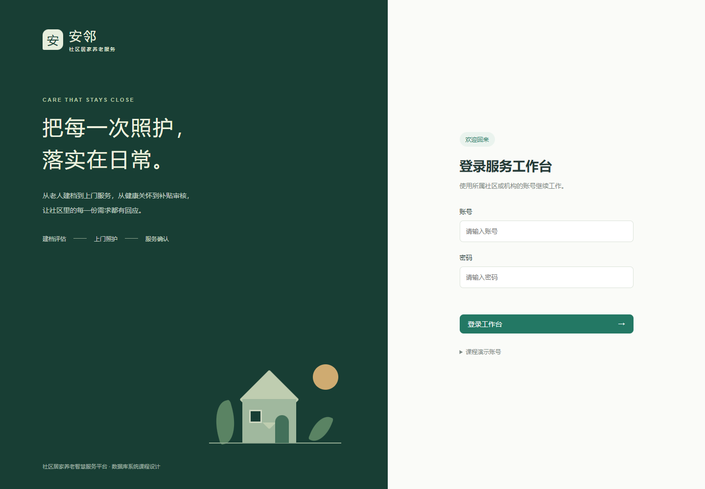
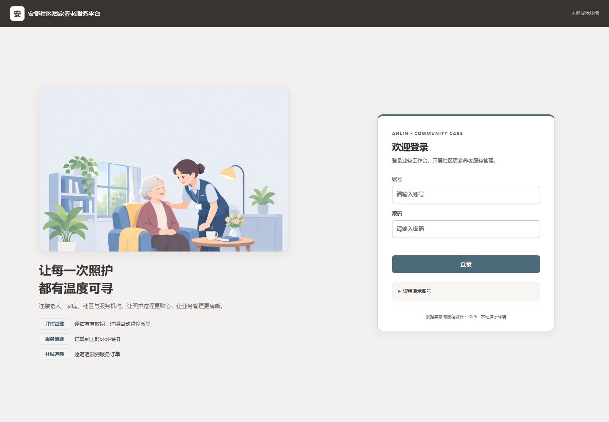
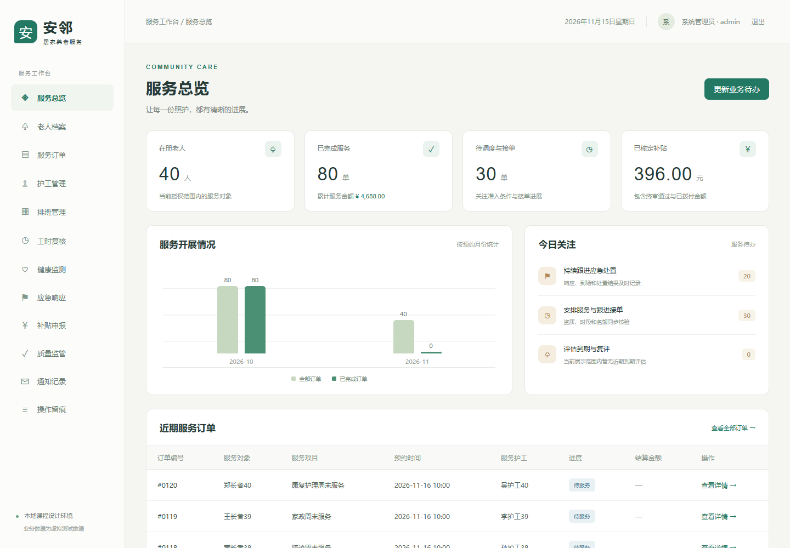
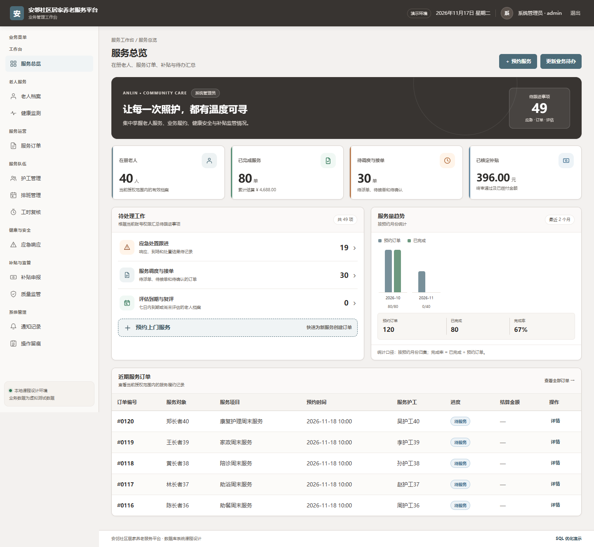
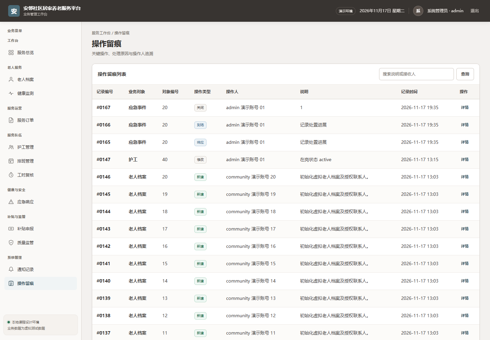
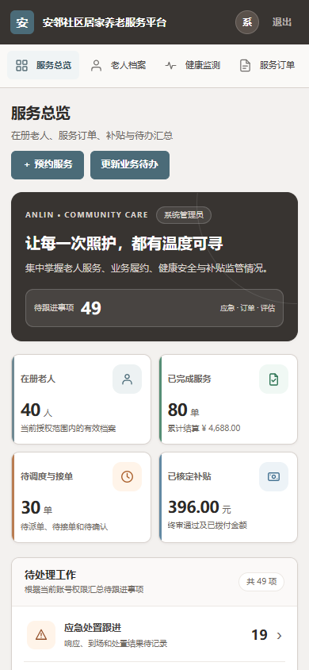

# 界面改版与操作留痕优化说明（2026-11-17）

> 对比基线：`3663cc8`（`Initial commit: 社区居家养老服务平台`）
> 本版提交：`ui/gui-redesign` 分支 HEAD（推送后对应用户 fork 的 `main`）
> 本地预览：`http://127.0.0.1:5001`，管理员 `admin / Care2026!`

## 1. 一页结论

本版把初版的“绿色品牌页 + 独立统计卡 + 可折叠菜单”改成社区养老业务后台的形态：深色全宽顶栏、240px 分组侧栏、KPI 横条、待办与趋势双栏、密集业务表格、语义化状态标签。登录页保留一张照护场景插画作为视觉锚点，业务页不再使用大图、渐变和重阴影。

同时修复了“操作留痕”被维护任务空转记录占满的问题：业务对象和操作类型改为中文，历史 `scheduler / tick` 行不再显示，新的维护任务只有在确实处理了数据时才写审计。

本版**只覆盖界面层和这一处审计噪声修复**；数据库核心脚本、接口路径、权限模型和测试基线保持初版不动。本地另一套 17 项数据库复核修复没有并入本分支，避免与组里已有的五项逻辑/后端修复混在一起；如需合并，应单独做一次带数据库回归的版本。

## 2. 提交范围

| 类别 | 文件 | 变化 |
| --- | --- | --- |
| 页面结构 | `care/templates/index.html` | 登录页、顶栏、侧栏、页头、列表、详情/表单弹窗、Toast 的结构重写 |
| 视觉样式 | `care/static/style.css` | 设计令牌、布局、表格、标签、弹窗、响应式整体替换 |
| 交互脚本 | `care/static/app.js` | 导航分组、工作台渲染、快捷预约、审计中文映射、详情/表单细节 |
| 登录插画 | `care/static/login-illustration.png` | 新增本地插画，1,263,017 字节，不依赖外部图床 |
| 审计过滤 | `care/queries.py` | 管理员和普通角色的审计列表都排除历史 `scheduler / tick` 行 |
| 维护任务 | `scripts/maintenance.py` | 空转不写审计；有实际处理时写中文 `maintenance` 摘要 |

相对 `3663cc8` 的代码差异：

```text
 care/queries.py                    |    5 +-
 care/static/app.js                 |  655 +++++----
 care/static/login-illustration.png |  Bin 0 -> 1263017 bytes
 care/static/style.css              | 2660 ++++++++++++++++++++++++++++++------
 care/templates/index.html          |  150 +-
 scripts/maintenance.py             |   25 +-
 6 files changed, 2843 insertions(+), 652 deletions(-)
```

> 上表是代码文件的差异；本文档和 `docs/evidence/screenshots/redesign/` 下的对照图是随本版新增的说明材料，不计入代码行数。

## 3. 设计方向

### 3.1 从“品牌宣传页”转到“业务后台”

初版的视觉重心是绿色品牌区、大标题和四张独立统计卡，页面更像课程展示页；本版把信息密度提上来，让登录后第一屏就能看到“有多少老人、多少订单待处理、补贴多少、今天要跟进什么”。

具体做法：

- 深色顶栏承担品牌和账号信息，页面主体用暖灰底承托白色面板。
- 侧栏按业务域分组，组标题只做导航，不再使用装饰性符号。
- 统计信息从四张独立卡片收成一条 KPI 横条，减少首屏纵向占用。
- 表格、状态标签、按钮统一为紧凑尺寸，适合连续查看和演示操作。
- 业务页不使用插画、渐变球、装饰性大图；唯一的插画留在登录页。

### 3.2 设计令牌

| 项目 | 取值 |
| --- | --- |
| 页面底色 | `#f3f1ef` |
| 面板底色 | `#ffffff` |
| 主色（陶土蓝） | `#4b6b78`，深色 `#38535e`，浅底 `#f0f4f5` |
| 顶栏 | `#383431` |
| 正文 | `#2c2a28`，次级 `#44413e`，弱化 `#6b6662` |
| 语义色 | 绿 `#2b7252`、琥珀 `#a85c27`、红 `#a63c32`、蓝 `#3b6b8c` |
| 字体 | `Microsoft YaHei UI`、`Microsoft YaHei`、`PingFang SC`、`Noto Sans CJK SC` |
| 圆角 | 6 / 10 / 14 / 18px，标签使用小方角 |
| 布局 | 顶栏 64px、侧栏 240px、内容最大宽度 1680px |
| 焦点态 | `0 0 0 3px rgba(75,107,120,.16)` |

不使用第三方 UI 框架、图标库或 CDN；导航图标是内联 SVG，登录插画是本地 PNG。

## 4. 信息架构对比

初版侧栏是六个可折叠分组，本版改成七个常驻分组，把“老人服务”“服务运营”“补贴与监管”拆开，减少演示时反复展开/收起：

| 初版分组 | 初版包含 | 本版分组 | 本版包含 |
| --- | --- | --- | --- |
| 服务工作台 | 服务总览 | 工作台 | 服务总览 |
| 老人档案与评估 | 老人档案 | 老人服务 | 老人档案、健康监测 |
| 服务下单与派单 | 服务订单 | 服务运营 | 服务订单 |
| 护工与排班 | 护工管理、排班管理、工时复核 | 服务队伍 | 护工管理、排班管理、工时复核 |
| 健康监测与应急 | 健康监测、应急响应 | 健康与安全 | 应急响应 |
| 补贴与质量监管 | 补贴申报、质量监管 | 补贴与监管 | 补贴申报、质量监管 |
| 通知与操作记录 | 通知记录、操作留痕 | 系统管理 | 通知记录、操作留痕 |

导航仍按角色过滤，`sections[key].roles` 是唯一权限来源；本版只改分组和呈现，不改变谁能看到哪一页。

## 5. 页面级改动

### 5.1 登录页

初版是 55/45 的深绿分栏：左侧品牌和宣传语，右侧登录表单。本版改为：

- 顶部一条深色系统条，品牌只出现一次，右侧标“本地演示环境”。
- 主体左侧是照护场景插画卡片，配“让每一次照护，都有温度可寻”和三条业务说明（评估管理、服务链路、补贴追溯）。
- 右侧白色登录卡：英文眉题 `ANLIN · COMMUNITY CARE`、欢迎语、账号/密码、登录按钮。
- 演示账号仍在 `<details>` 折叠区，不占用首屏。
- 底部保留“数据库系统课程设计 · 2026 · 本地演示环境”。

| 初版 | 本版 |
|:---:|:---:|
|  |  |

### 5.2 顶栏与侧栏

- 顶栏改为全宽深色，高 64px；左侧品牌“安”字标 + 系统名 + “业务管理工作台”，右侧依次是演示环境标签、日期、头像、角色/账号、退出。
- 侧栏固定 240px，顶部“业务菜单”，下面按七个分组渲染；每个菜单项带内联 SVG 图标，当前项有浅色底和左侧强调线。
- 侧栏底部是环境说明：“本地课程设计环境 / 业务数据为虚拟测试数据”。
- 主内容区增加面包屑、页标题、页描述和页级操作按钮；底部页脚保留“SQL 优化演示”入口。
- 增加“跳转到主要内容”链接，键盘用户可以直接跳过导航。

### 5.3 服务总览

初版是“四张统计卡 + 服务开展情况柱状图 + 今日关注 + 近期订单”。本版重排为：

1. **欢迎区**：深色 Hero，左侧英文眉题、当前角色、主标题和一句业务说明；右侧“待跟进事项”总数（应急 + 订单 + 评估）。
2. **KPI 横条**：在册老人、已完成服务、待调度与接单、已核定补贴。每项带图标、单位、口径说明；补贴显示为金额。
3. **待处理工作**：三行表格式待办（应急处置跟进、服务调度与接单、评估到期与复评），每行有数量、说明和进入对应页面的箭头。
4. **快捷预约**：待办下方增加“预约上门服务”虚线按钮，管理员、社区、家属、老人可见；点击直接打开预约表单。
5. **服务量趋势**：最近 6 个月的双层柱状图，图例区分“预约订单/已完成”，下方汇总预约总数、已完成总数、完成率，并写明“完成率 = 已完成 ÷ 预约订单”。
6. **近期服务订单**：保留 5 行表格，行尾“详情”，右上角“查看全部订单”。

| 初版 | 本版 |
|:---:|:---:|
|  |  |

### 5.4 列表、详情与表单

- 各业务列表统一为“页头 + 面板 + 工具条 + 表格 + 分页”的结构；表头固定文案，行高更紧凑，适合一屏看更多记录。
- 状态列继续用 `badge`，但颜色按语义收敛：待处理/待确认用琥珀，服务中/处理中用蓝，异常/驳回用红，已取消/已结束用灰。
- 日期、金额、能力等级、围栏校验、指标名称继续在 `cell()` 中做格式化；长文本超过 38 字截断并加省略号。
- 空列表有独立空态：说明“当前范围内暂无记录”；带搜索词时显示“没有匹配「…」的记录”，并提供“清除搜索条件”。
- 详情弹窗改为“记录详情”标题 + 三列字段网格；订单详情仍保留费用、投诉、状态操作等追加区块。
- 表单弹窗保持两列；长文本用整行 `textarea`，复选框单独样式；提交期间按钮禁用，错误在表单内显示。
- 列表请求用 `renderVersion` 防止快速切换页面时旧响应覆盖新页面。

### 5.5 操作留痕

这是本版唯一涉及后端行为的改动，目的是让“操作留痕”真的能看：

- `care/static/app.js` 新增 `auditEntities`（16 个业务对象）和 `auditActions`（25 个操作）映射；表格不再显示 `worker / elderly / create / update` 这类英文代码。
- 操作类型按语义加浅色标签：新建/完成/拨付/审核通过为绿，派单/提交/复核/抽查/响应/到场为蓝，取消/终止/转异常/驳回/删除为红，其余为灰。
- 表头从“操作”改为“操作类型”，与行尾“操作/详情”列区分。
- `care/queries.py`：管理员和普通角色的审计列表都加上 `NOT (o.entity='scheduler' AND o.action='tick')`，历史 17 条空转记录仍在 `audit_log` 中，只是不在页面显示。
- `scripts/maintenance.py`：先取到期、应急、通知三个结果；只有 `paused_plans`、`released_assignments`、`escalated_count` 或通知数任一非 0 时才写审计，且写成中文 `maintenance` 摘要，不再写整段 JSON。

验证结果：管理员“操作留痕”首行从 `#0164 系统任务 / 系统轮询` 变为 `#0167 应急事件 / 关闭`，之后是 `#0147 护工 / 修改` 等真实业务记录。



### 5.6 响应式与可访问性

- 宽度小于 1100px 时侧栏收窄；小于 820px 时顶栏压缩、侧栏变成横向菜单，KPI 改两列，表格在容器内横向滚动，表单改单列。
- 小于 520px 时详情字段改单列。
- 390×844 下 `document.documentElement.scrollWidth = 390`，页面没有整体横向溢出。
- 交互控件保留 `aria-label`、`role="alert"`、`role="status"`；弹窗使用原生 `<dialog>`，支持 Esc 关闭。
- 焦点态统一为 3px 浅蓝外圈；按钮、输入框、链接都有可见的 hover/focus 变化。



## 6. 技术实现要点

### 6.1 `index.html`

- 登录页和业务工作台拆成 `#login-screen` 与 `#workspace` 两个顶层区块，登录后只切换显示，不重载页面。
- 顶栏、侧栏、页头、列表、详情弹窗、表单弹窗、Toast 都保留原有 id/class 钩子，`app.js` 的查询选择器不需要大改。
- 新增登录插画 ``、演示账号折叠区、页脚 SQL 优化入口。

### 6.2 `style.css`

- 文件开头集中定义设计令牌（颜色、圆角、阴影、间距、字体、布局尺寸），后面组件只引用变量。
- 主要区块：`login-*`、`topbar`、`sidebar`、`page-content`、`kpi-*`、`task-*`、`trend-*`、`table-*`、`detail-*`、`form-*`、`toast`。
- 审计标签新增 `.audit-entity`、`.audit-action` 及 `is-success / is-info / is-danger` 三种色调。
- 响应式断点集中在文件末尾，避免组件样式和媒体查询互相覆盖。

### 6.3 `app.js`

- `navGroups` 定义七个分组；`NAV_ICONS` 保存 12 个内联 SVG 路径；`start()` 按角色过滤后渲染侧栏。
- `renderOverview()` 并行请求 `/api/dashboard` 和 `/api/list/orders`，用 `renderVersion` 防止竞态；KPI、趋势、待办都从接口数据计算，不在前端写死。
- `openBookingForm()` 从 `topActions('overview')` 中抽出，页头“预约服务”和待办区“预约上门服务”共用同一表单。
- `cell()` 增加 `entity`、`action` 两种类型；`auditActionTone` 决定标签颜色。
- 列表空态、搜索清除、分页禁用、Toast 提示都在原有事件委托上扩展，没有引入新依赖。

## 7. 文件差异

| 文件 | 新增 | 删除 | 说明 |
| --- | ---: | ---: | --- |
| `care/templates/index.html` | 119 | 31 | 结构重写 |
| `care/static/style.css` | 2275 | 385 | 设计系统与组件样式 |
| `care/static/app.js` | 424 | 231 | 导航、工作台、审计、交互 |
| `care/static/login-illustration.png` | 二进制 | — | 1,263,017 字节 |
| `care/queries.py` | 4 | 1 | 审计列表过滤 |
| `scripts/maintenance.py` | 21 | 4 | 空转不写审计 |

## 8. 验证

- 浏览器检查：`docs/evidence/redesign/browser-check.json`
  - 12 个页面：总览、老人档案、服务订单、护工管理、排班管理、工时复核、健康监测、应急响应、补贴申报、质量监管、通知记录、操作留痕。
  - `javascript_errors: []`，无页面脚本异常。
  - 移动端 390×844：`scrollWidth = 390`，`result: passed`。
- 登录：`admin / Care2026!` 可进入工作台；页面标题、角色、日期正常显示。
- 审计：首行 `#0167 应急事件 / 关闭`，历史 `scheduler / tick` 行不再出现；业务对象、操作类型均为中文。
- 截图：`docs/evidence/screenshots/redesign/` 下 9 张对照图，桌面 1440×1000，移动 390×844。
- 后端审计修复与本地完整工程中的同一修复一致；本地完整工程此前 `pytest` 65 项全通过。本分支未改数据库核心脚本，未重新跑分支的 64 项测试。

## 9. 复现与预览

```powershell
cd care-platform-git
python -m venv .venv
.\.venv\Scripts\python.exe -m pip install -r requirements.txt
.\start.ps1
```

浏览器打开 `http://127.0.0.1:5000`，使用 `admin / Care2026!` 登录。若只做界面预览，也可以：

```powershell
.\.venv\Scripts\python.exe -c "from care.app import create_app; app=create_app(); app.run(host='127.0.0.1', port=5001, debug=False)"
```

## 10. 边界与后续

- 本版是**界面版**：不改表结构、视图、过程、触发器、权限和接口契约。
- 组里 `main` 上已有的五项逻辑修复、后端功能修复文档与测试保持原样，本版没有覆盖或删除。
- 本地另一套 17 项数据库复核修复（F01—F17）不在本分支内；它和组里的修复是两条线，合并前需要先对齐 SQL 与测试基线，不能直接叠加。
- 登录插画是本地资源，后续如要更换，只需替换 `care/static/login-illustration.png`，不影响布局。
- 如果后续要把本版合回组里仓库，建议只 cherry-pick 四个前端文件和审计两处小改，再在组里数据库上跑一次完整回归。
