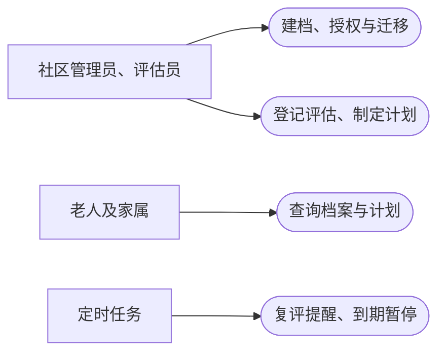
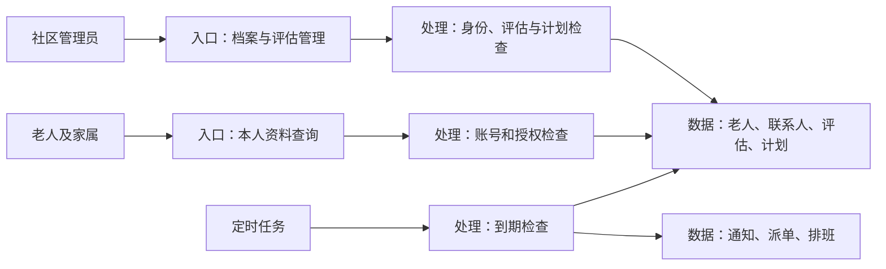
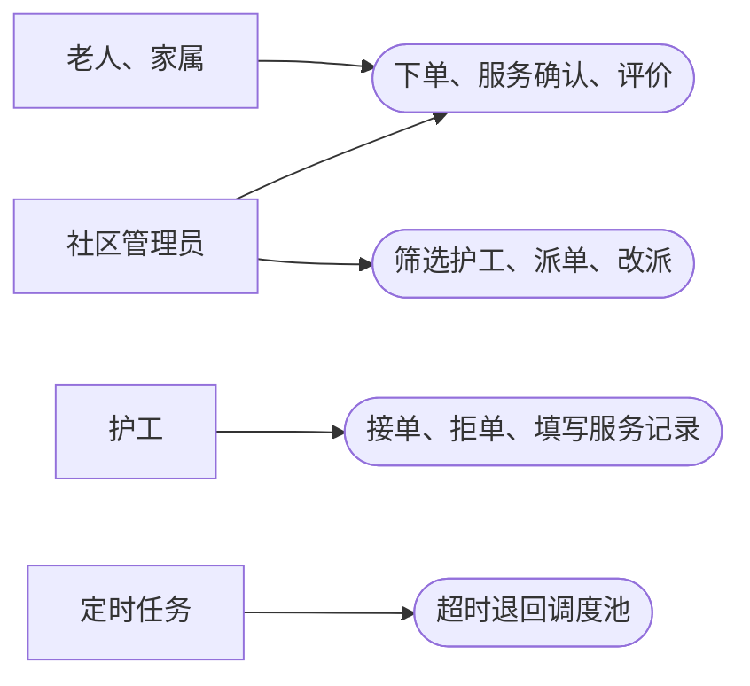
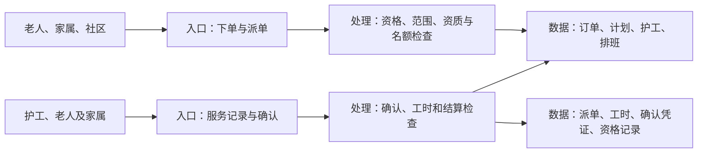
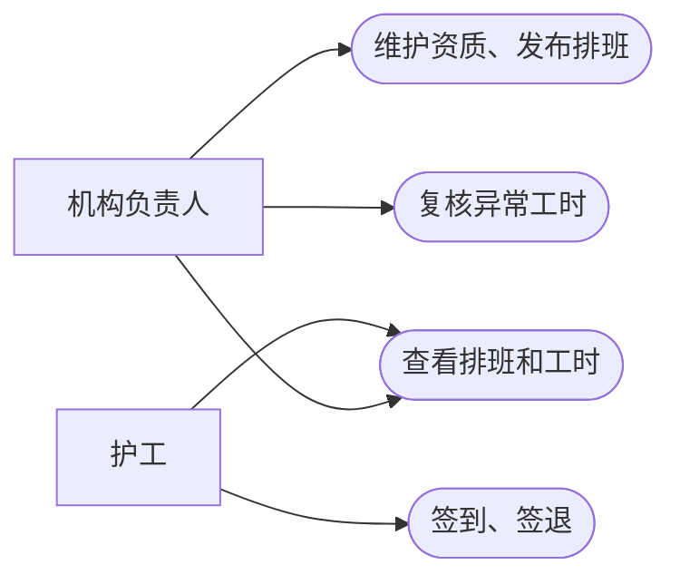
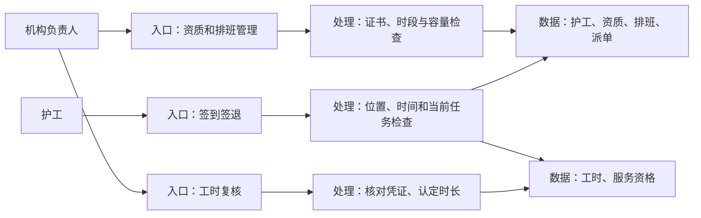
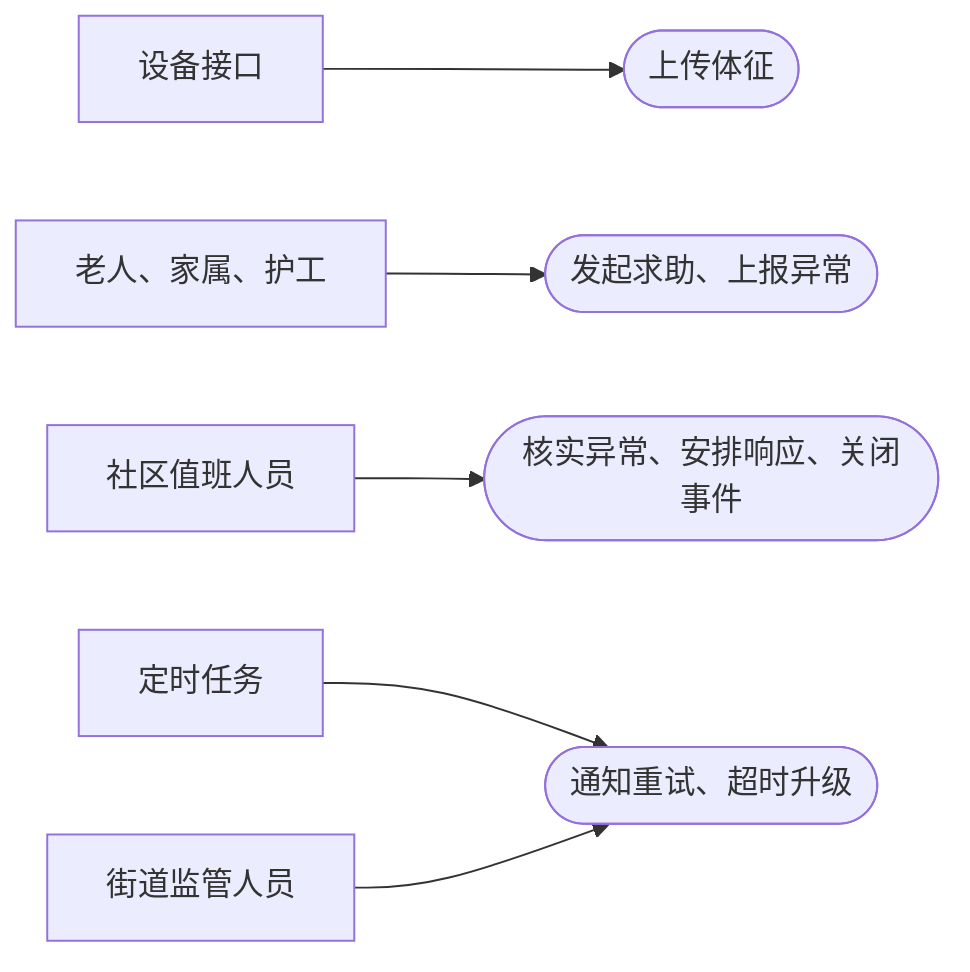
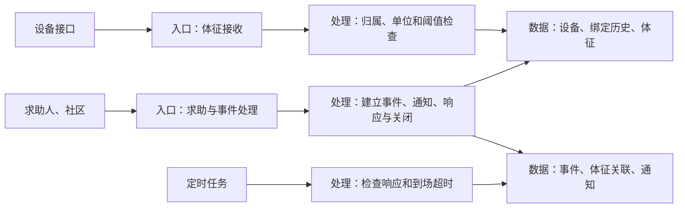
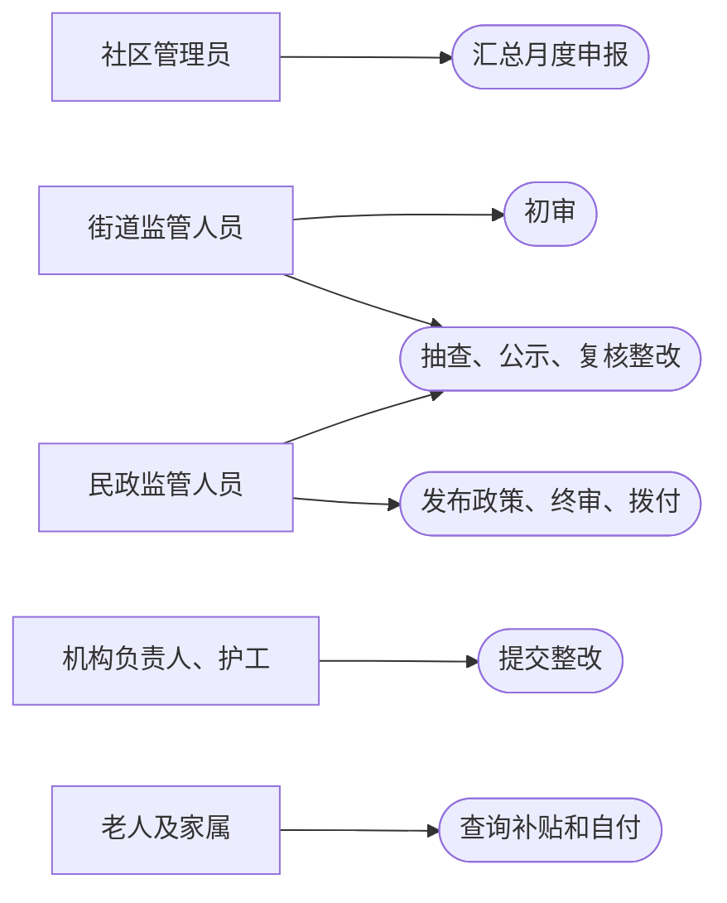
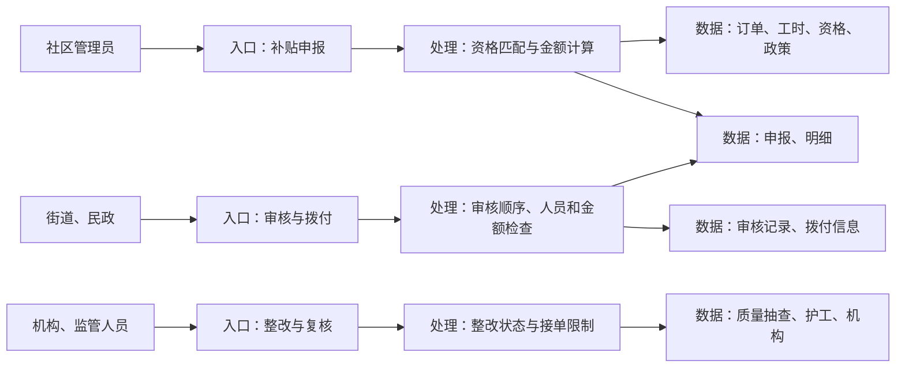

# 社区居家养老智慧服务平台业务分析

## 1. 平台要解决什么问题

社区为居家老人提供助餐、助浴、陪诊、家政和康复护理等服务。平台把老人档案、能力评估、照护计划、护工排班、服务订单和补贴申请放在一起管理，让社区知道老人需要什么服务、谁来提供、是否完成、费用怎么算。

日常服务从建档开始。社区完成能力评估后制定照护计划，老人、家属或社区工作人员提出服务需求，系统筛选合适的护工，社区完成派单。护工上门服务并记录工时，经老人或家属确认后结算。符合条件的订单按月申请补贴。

健康监测和紧急求助贯穿整个服务过程。设备上传异常数据或老人发起求助后，社区安排人员处理，记录通知、响应、到场和处置结果。监管人员定期抽查服务质量，跟踪整改。

课设采用同一区县内多个街道、社区和服务机构的场景，支持老人跨社区迁移。设备上传、消息发送和拨付使用模拟接口。

## 2. 谁来使用平台

| 角色 | 主要工作 | 可以查看的数据 |
| --- | --- | --- |
| 老人 | 查看评估和计划，下单，确认服务，评价或投诉，查看补贴与自付金额 | 本人资料和订单 |
| 家属 | 为老人代办上述事项，发起紧急求助 | 获得授权的老人资料 |
| 社区服务管理员 | 建档、组织评估、制定计划、派单和改派、处理投诉、申报补贴、处理社区告警 | 所管理社区的数据 |
| 护工 | 接单、签到签退、填写服务记录、上报异常，查看排班和工时 | 本人的任务及服务所需资料 |
| 服务机构负责人 | 管理护工资质、培训和排班，复核异常工时，协调任务，处理整改 | 本机构的数据 |
| 街道监管人员 | 初审补贴、抽查服务、跟踪整改，查看服务覆盖和应急处理情况 | 所辖街道的数据 |
| 民政监管人员 | 管理补贴政策、终审申报、登记拨付、开展监管 | 所辖区县的数据 |

账号和角色由系统管理员配置。业务操作同时检查角色和管理范围。例如，社区管理员只能给自己管理范围内的订单派单；护工不能复核自己的工时；机构负责人不能自行解除监管部门对本机构的整改限制。

家属通过联系人记录取得授权。授权撤销后，账号停止查看和代办该老人的新业务，已经完成的服务确认仍然保留。线下签字由老人或家属本人完成，工作人员可以上传签字凭证，系统分别记录签字人和录入人。

## 3. 老人档案与能力评估

### 3.1 建档和迁移

每位老人只有一份档案，内容包括姓名、身份证、出生日期、住址、所属社区、联系人和独居、失能、低保等标签。身份证用于检查重复建档，保存时加密，页面显示时隐藏部分号码。独居、失能和低保分别记录，允许同时存在。

一位老人可以登记多名联系人，其中最多一名有效主联系人。在册老人至少保留一名有效联系人，方便社区联系和处理紧急情况。

老人搬到另一个社区时，更新原档案的社区和住址。已发生的订单保留原来的服务地址、社区和价格，应急事件也保留发生时的社区。

### 3.2 评估与照护计划

评估员记录量表、得分、能力等级、评估日期和有效期。能力等级分为能力完好、轻度失能、中度失能和重度失能。测试量表暂用ADL 0至100分、简易智能状态0至30分，能力等级由评估员录入。

同一老人同一天保存一份最终评估。判断当前资格时，先取当天及以前最新的一份评估，再看它是否过期。如果新评估已经过期，即使更早的评估还在有效期内，也需要复评。

社区根据能力等级选择服务包，制定照护计划，逐项填写服务项目、频次、起止日期和责任护工。一个老人同一时段只能有一份生效计划。计划暂停后重新启用，也要检查是否与其他计划重叠。

计划中的频次表示照护目标。例如每周助浴两次，系统可以统计是否完成。这里不把频次设为下单上限。

### 3.3 到期和复评

系统提前7天提醒复评，评估过期后暂停照护计划和新的派单。未来预约也要检查评估能否覆盖服务当天。

复评后，等级仍与服务包匹配的，可以继续或恢复原计划；等级变化的，结束原计划并制定新计划。已经派出但尚未开始的订单重新检查资格，必要时取消原派单并释放名额。已经开始的服务可以继续完成，紧急求助也继续处理。

服务开始时，系统保存该订单使用的评估、计划和当时的低保资格。以后申报补贴时读取这份记录。例如，老人服务当天享有低保资格，月底取消了低保标签，已经发生的服务仍按当时的情况核算。

已被服务使用的评估结果、计划项目和频次保留原记录。计划可以暂停或结束，但调整结束日期时不能把已经发生的服务排除在有效期之外。

### 3.4 需要保存的数据

| 数据 | 主要内容 |
| --- | --- |
| 老人档案 | 身份、住址、社区、特殊标签、档案状态、关联账号 |
| 老人联系人 | 姓名、关系、联系方式、监护人和主联系人标记、授权起止时间 |
| 能力评估 | 量表、得分、等级、评估员、日期和有效期 |
| 服务包及服务包项目 | 适用等级、项目和建议频次 |
| 照护计划及计划项目 | 老人、服务包、责任护工、有效期、各项目频次和计划状态 |

## 4. 服务下单与派单

### 4.1 下单和筛选护工

老人、家属或社区工作人员选择项目和预约时间。系统保存当时的服务地址、社区、经纬度、单价和预约时长。以后老人搬家或项目调价，这些订单信息保持原值。需要改到新地址服务时，取消尚未开始的旧单，再创建新单。

订单可以派出前，要满足以下条件：

- 老人档案在册，能力评估覆盖服务日期。
- 有覆盖预约日期的生效计划，所选项目在计划内。
- 服务地址位于所属社区的服务范围内。

不满足条件的订单停留在“待准入”，即等待补齐服务条件。

筛选护工时，系统检查在岗状态、服务区域、可服务项目、证书和排班。护工还要有剩余名额，预约时间不能与其他有效任务重叠，也不能受到相关整改限制。计划中的责任护工满足条件时优先推荐，管理员手动派单也执行相同检查。

有证书要求的项目，需要护工持有相同类型、达到最低等级且覆盖服务时间的证书。证书等级用1、2、3表示初、中、高级。没有证书要求的项目仍要检查区域、排班和其他条件。

### 4.2 接单、改派和取消

派单时占用班次的一个名额，护工接单时不重复占用。15分钟未接单的，原派单记为超时，释放名额，订单返回调度池，由社区重新安排。

护工拒单、服务前取消或派单失效时，同样释放名额。改派时保留原派单及原因，再创建新派单，一笔订单同时只能有一条有效派单。

服务前改期需要释放原名额，重新检查资格、排班和时间冲突。改期保留下单单价；按次项目沿用原订单保存的标准时长。修改项目或服务地址则取消后重新下单。

### 4.3 服务完成和确认

护工签到开始服务，签退后订单进入“待确认”。结算前需要同时满足：

1. 护工已填写服务记录。
2. 老人或获授权家属已确认。电子确认记录实际账号，纸质确认保存护工与老人或家属双方签字的凭证。
3. 工时已认定，时长大于0。

确认时间应晚于服务结束。如果确认后又修改了服务内容，需要重新确认。系统只有在“待确认”状态下检查这些条件，满足后同时完成订单、派单和结算，并记入护工累计工时和积分。

出现中断或争议的订单进入“异常”。社区核实后，能够结算的恢复到“待确认”；无法结算的记为“已终止”，保留服务记录和处理原因。正常等待家属确认或工时复核时，订单继续等待，不直接判为异常。

### 4.4 费用怎么算

预约时长以分钟记录，工时以小时记录，金额保留两位小数。

| 计价方式 | 下单时的预计金额 | 完成后的结算金额 |
| --- | --- | --- |
| 按次 | 下单单价 | 下单单价 |
| 按小时 | 下单单价 × 预约分钟数 ÷ 60 | 下单单价 × 实际认定工时与预约小时数中的较小值 |

例如每小时60元，预约90分钟，预计金额为90元；实际认定1.25小时，结算金额为75元。后来指导价上涨，不影响这笔订单。

订单完成后，价格、预约时间、服务归属、工时和结算金额保留原值，评价和投诉仍可以填写。投诉统计按最终完成服务的护工计算；涉及改派前护工的具体问题，另在处理记录中注明原派单。

### 4.5 订单状态

| 状态 | 含义及下一步 |
| --- | --- |
| 待准入 | 服务条件未齐，补齐后进入待派单 |
| 待派单 | 等待社区安排护工 |
| 待接单 | 已派出，等待护工接单 |
| 待服务 | 护工已接单，等待上门 |
| 服务中 | 已签到，正在提供服务 |
| 待确认 | 服务已结束，等待记录、确认或工时认定 |
| 已完成 | 完成结算，计入工时和补贴筛选 |
| 已取消 | 服务开始前取消 |
| 异常 | 服务中断、存在争议或工时复核未通过，等待处理 |
| 已终止 | 异常处理后确定无法结算，不申请补贴 |

订单、派单、工时和资格记录之间的主要关系是：一个订单可以有多次派单，一次派单最多有一条工时记录；一个订单保存一份服务时资格记录。派单通过排班找到护工，工时通过派单找到护工。

## 5. 护工与排班

### 5.1 资质和班次

机构负责人维护护工档案、证书、可服务项目、服务区域和培训情况，按月发布排班。班次包括日期、开始和结束时刻、可接单量、已接单量及状态。

班次在同一天内开始和结束，落在护工每天可服务的时段内。同一护工的班次和预约任务都不能重叠。10:00结束的班次可以接着10:00开始的班次，但上一单实际尚未结束时，下一单不能签到。

同类型、同编号的证书只登记一次。一名护工可以持有同类型的多张证书。休假、离职或机构停用后，系统停止给该护工派新单，并处理尚未开始的任务。

课设中，已有业务记录的护工保持原机构归属，社区与街道的隶属关系也保持稳定，历史服务和整改责任按原归属查询。

### 5.2 名额如何增减

| 操作 | 班次名额变化 |
| --- | --- |
| 创建派单 | 已接单量加1 |
| 护工接单 | 不变 |
| 拒单、超时、服务前取消或失效 | 已接单量减1 |
| 改派 | 原班次减1，新班次加1 |
| 服务完成 | 保留已使用名额 |
| 异常终止 | 尚未服务的释放名额；已经开始的保留已使用名额 |

“已接单量”统计本班次已经占用或使用的名额，始终满足0到可接单量之间的范围。系统也能根据派单记录重新计算这一数量。

### 5.3 签到、签退和工时

签到位置以订单保存的服务住址为中心，默认允许距离为200米。它与“社区能提供服务的范围”分别设置。

签到和签退时间合法、实际服务位于班次及预约时段内、位置检查通过时，按实际起止时间计算工时，换算为小时并保留两位小数。提前到达、延时结束、位置异常或缺签时，由机构负责人复核。

复核人员要填写实际时长、处理说明和凭证。漏签退的补齐结束时间；漏签到的先作为异常处理，核实实际起止时间和服务当天的资格后补录。补录时间记录实际操作时间，位置仍标为未核验。护工不能复核自己的工时。

复核通过后，还要等待服务记录和老人确认齐全才能结算。工时无法认定的，由社区继续处理或终止订单。

### 5.4 工时和评分

月度有效工时按订单预约月份统计，只包含已完成订单的认定工时。待确认、异常和已终止订单不计入已完成服务工时。累计工时等于各月份工时之和。

护工每完成一单增加1积分。评分取该护工已完成订单评价和服务抽查评分的平均值，评价及抽查均为1至5分；没有样本时显示“暂无评分”。

## 6. 健康监测与应急响应

### 6.1 设备绑定和数据归属

社区登记设备类型、安装位置和状态，再绑定老人。同一设备同一时段只能属于一位老人。

设备表保存当前绑定，绑定历史表保存已经结束的绑定。换绑时先结束旧绑定，再开始新绑定。数据按采集时间确定归属：旧绑定结束的那个时刻起，归新绑定老人。

一条体征数据包括设备、采集时间、接收时间、指标、数值、来源和确认状态。采集时间用于判断归属，接收时间用于识别设备断网后的补传。同一设备、同一采集时间、同一指标只保存一条；重复上传相同内容直接返回原记录，内容冲突则交由工作人员处理。

每种指标在配置中设置单位和上下限。数值小于下限或大于上限时标为异常，等于边界时视为范围内。异常先进入待确认，由工作人员核实。测试采用示例阈值，已使用的阈值和单位保留原值。

### 6.2 从告警到处置

普通体征异常由社区值班人员或护工核实，需要处理时创建应急事件，并关联具体体征记录。一键呼叫、跌倒告警、家属呼叫和主动求助直接创建事件。

系统分别通知主联系人、可用的责任护工和社区值班人员，记录每个接收人的发送结果。联系人没有账号时可以使用模拟电话或短信。发送失败先提醒社区，再按设置重试，最多3次后转人工处理。

事件记录发生时社区、等级、来源、发生时间、响应人、响应时间、到场时间和处置结果。社区安排了人员后，实际开始处理时才记录“已响应”。处理完毕后填写结果，由管理员关闭。

### 6.3 超时和特殊情况

等级决定响应和到场时限。待响应事件达到时限后，系统通知街道监管人员和社区管理员；已经响应但迟迟未到场的，继续列在超时待办中。

同一事件的同一次升级只处理一次。重复核实同一条异常体征，也不重复创建事件。误报可以说明原因后关闭，保留处理人和时间。

老人评估过期、计划暂停或档案停用时，紧急求助仍能处理。老人后来迁移社区，旧事件继续由发生时社区负责。

事件状态分为待响应、处理中和已关闭。通知失败不会删除事件，工作人员能看到失败原因和重试记录。

## 7. 补贴核算与服务质量监管

### 7.1 政策与资格

政策记录适用区县、能力等级、服务项目、补贴标准、结算周期和有效期。本设计按自然月结算，政策从月初生效，到指定月末失效，同一条件下的政策月份不重叠。

订单按下单时社区、服务时的评估和低保资格匹配政策。低保老人优先使用低保专用政策，没有专用政策时再使用不限低保的政策。一笔订单只匹配一条政策。

已发布政策的标准和适用范围保留原值，调整时创建新版本。月内复评或后来改变低保标签，不影响已经发生的服务。

### 7.2 按月申报

同一老人、同一服务项目、同一月份只提交一份申报，一笔订单也只能进入一份申报。

社区最早在次月1日00:00汇总上月订单。提交前，同组订单需要全部完成、取消或终止。还有待确认或异常订单时，申报保留为草稿，社区继续处理这些订单。

已完成、项目可补贴、确认和工时齐全、服务资格明确的订单进入明细。没有适用政策的显示原因；缺少服务记录或资格材料的，需要先补齐再提交。

同月在A、B两个社区接受过服务的老人，由首次提交时所在社区合并申报，明细分别使用各订单下单社区的政策。提交后由该社区继续办理，后续迁移不改变本单的审核辖区。

### 7.3 金额计算

按次项目的计量数量为1；计时项目取认定工时与预约小时数中的较小值。

单项补贴取“计量数量×补贴标准”和“订单结算金额”中的较小值。申报总额等于各项补贴之和。

| 状态 | 向老人展示的金额 |
| --- | --- |
| 草稿或审核中 | 预计补贴、预计自付 |
| 终审通过 | 核定补贴、核定自付 |
| 审核不通过 | 核定补贴为0，自付为全部服务费用 |
| 已拨付 | 展示核定金额及拨付时间 |

自付金额等于服务费用减去对应补贴。尚未申报的订单仍然显示服务费用和补贴状态。

### 7.4 审核和拨付

申报由街道初审、民政终审。每次审核都记录审核人、结论、意见和时间，退回后从初审重新开始。

划分审核轮次时，以最近一条退回记录为界，只有之后的初审通过记录才能用于本轮终审。这样即使两次操作的时间相同，也能按记录顺序区分。

同一申报的初审人和终审人在所有轮次中保持分离，审核人不能是本次提交人。审核期间保留提交时的金额和材料，需要修改时先退回。终审通过后固定金额和明细。

拨付登记只处理“终审通过且未拨付”的申报，保存经办人、时间和唯一凭证号。重复提交同一请求返回原结果。

### 7.5 抽查与整改

监管人员每月在辖区已完成订单中抽查10%，向上取整，有订单时至少抽查一单。记录抽样批次和名单，也可以直接抽查护工。

每条抽查填写订单或护工其中一个对象，记录方式、评分和发现的问题。有问题时还要填写责任对象、整改要求、期限及受限服务项目。责任对象可以是护工或机构；未指定项目时限制全部项目。

整改期间，系统停止向受限对象派出相关新任务，并安排尚未开始的任务改派。进行中的服务由社区根据实际情况处理。

机构提交整改结果后进入“待复核”，监管人员确认完成后解除该条限制。如果还有其他未完成整改，相关限制继续生效。公示只展示必要的服务质量信息，个人身份、联系方式和详细体征不公开。

抽查评分计入护工评分，机构考核取所属护工抽查评分的平均值。

## 8. 各业务共用的数据和规则

### 8.1 数据关系

| 范围 | 数据表 |
| --- | --- |
| 基础资料和权限 | 行政区划、社区、服务机构、用户、角色、用户角色 |
| 档案评估 | 老人档案、老人联系人、能力评估、服务包、服务包项目、照护计划、计划服务项目 |
| 订单服务 | 服务项目、服务订单、派单记录、服务准入依据 |
| 护工排班 | 护工档案、护工资质、护工服务项目、护工服务区域、排班信息、工时记录 |
| 健康应急 | 监测设备、设备绑定历史、体征数据、指标阈值、事件等级时限、应急事件、事件体征关联 |
| 补贴监管 | 补贴政策、补贴申报、申报明细、申报审核记录、质量抽查 |
| 操作和通知 | 业务审计记录、通知记录 |

服务准入依据保存每笔服务当时使用的评估、计划和资格。业务审计记录保存迁移、改期、异常处理、审核等操作的人员、时间、前后变化和原因。通知记录保存接收人、发送结果和重试情况。

项目清单、服务区域、订单集合等通过关联表逐项保存。派单中的护工信息通过排班查询，体征中的老人信息通过绑定历史查询，服务包名称通过服务包表查询。

### 8.2 多人同时操作

派单、修改名额和保存订单状态在同一笔数据库事务中完成，中间失败时一起撤销。

检查排班和派单时，先锁定同一护工的记录，再检查所有相关班次和任务。检查照护计划时锁定老人，设备换绑时锁定设备，审核时锁定申报记录。两个人同时争抢最后一个名额时，只允许一个人成功。

重复下单、重复完成服务、重复上传数据和重复拨付，都返回原处理结果，避免重复生成订单、累加工时或登记金额。

### 8.3 时间与历史记录

日期有效期包括起止两天；时间区间包括开始时刻、不包括结束时刻。预约和班次安排在同一天内，统一使用北京时间。

主键、外键和唯一约束检查记录是否存在、是否重复。涉及多张表的规则由业务过程统一检查，例如评估和计划是否属于订单老人、体征来源是否属于事件老人。

系统允许还没发生的时间暂时为空，例如待接单时没有接单时间。进入下一状态时再检查相应材料是否齐全。

### 8.4 自动提醒和处理

调度器每分钟检查评估到期、接单超时、应急超时和通知重试，并调用对应的存储过程。每轮记录处理数量及失败原因，发现遗漏时补处理，正常情况下在2分钟内发现到期事项。

### 8.5 安全与备份

密码采用加盐哈希保存，身份证和联系电话加密存储，页面按角色隐藏敏感内容。SQL使用参数化查询。连续5次登录失败锁定30分钟，会话30分钟无操作后超时。

家属只访问获授权老人，护工只访问服务所需资料，社区、街道和民政按各自辖区查询。导出数据遵守相同权限。

每周做一次全量备份，每日做增量备份，每15分钟归档事务日志，备份保存到独立位置。恢复目标为最多丢失1小时数据、4小时内完成恢复，密钥另行保管和备份。

提交前进行一次恢复演练，检查订单、工时、补贴金额和关联记录是否完整，并记录恢复耗时。

## 9. 统计与数据库功能安排

### 9.1 统计方法

| 指标 | 计算方法 |
| --- | --- |
| 护工月有效工时 | 预约月份内已完成订单的认定工时合计 |
| 平台订单完成率 | 已完成订单数 ÷ 除已取消外的订单数 |
| 护工订单完成率 | 该护工已完成订单数 ÷ 当前有效分配及已终止的订单数；改派前的派单不重复计算 |
| 护工投诉率 | 已完成且有投诉的订单数 ÷ 已完成订单数，按最终完成服务的护工归属 |
| 服务覆盖率 | 当前辖区在册老人中，本月有完成订单的人数 ÷ 当前在册人数 |
| 应急处理情况 | 事件数、平均响应和到场时长、未响应超时数、到场超时数、升级数 |
| 补贴情况 | 服务费用、预计与核定补贴、自付金额、审核和拨付进度 |

订单相关统计统一按预约月份计算，应急事件按发生月份及发生时社区计算。没有响应或到场的事件不作为0时长参与平均，报表同时显示参与平均的数量。分母为0时显示“暂无数据”。

例如一笔订单由A改派给B并完成，完成率只计入B。如果B当月有一单完成且收到投诉、另一单异常，则完成率为1/2，投诉率为1/1。

### 9.2 视图、存储过程和触发器

每条业务线安排至少3个视图、1个存储过程和1个触发器。

| 业务线 | 视图 | 存储过程 | 触发器 |
| --- | --- | --- | --- |
| 档案评估 | 当前评估与计划、复评提醒、档案脱敏 | 到期暂停计划并处理未开始任务 | 保留已用于服务的评估结果 |
| 订单派单 | 调度池、订单全过程、待确认订单 | 派单、改派、完成与结算 | 完成时更新累计工时和积分，限制修改已完成依据 |
| 排班工时 | 排班余量、月工时、待复核工时 | 发布班次、检查冲突、复核工时 | 限制修改已被派单引用的班次信息 |
| 健康应急 | 体征归属、待确认异常、未完成事件、响应统计 | 换绑、建立事件、超时升级 | 体征写入时标记异常 |
| 补贴监管 | 申报进度、可申报订单、整改限制 | 月度申报、审核、拨付 | 限制修改终审通过的金额和明细 |

### 9.3 SQL查询安排

每条业务安排3项查询，各写两种实现并比较。标有“多表”的5项至少关联3张表。

| 编号 | 查询需求 | 两种实现的比较方向 |
| --- | --- | --- |
| SQL-A1（多表） | 社区重度失能且计划有效的老人和责任护工 | 多表JOIN / 先筛最新评估的派生表或CTE再JOIN |
| SQL-A2 | 未来7天待复评名单，排除已完成新评估者 | NOT EXISTS / LEFT JOIN后筛空 |
| SQL-A3 | 各社区各能力等级的在册人数，含零人数类别 | 条件聚合 / 按等级分组后补齐字典 |
| SQL-B1（多表） | 订单、历次派单、班次、工时、确认和结算信息 | 分层JOIN / 按订单预聚合后JOIN，防止历史派单放大金额 |
| SQL-B2 | 超过15分钟未接单且仍可调度的订单 | EXISTS / 对有效派单分组后关联 |
| SQL-B3 | 缺服务记录、确认或有效工时的待确认原因 | CASE逐项标记 / 各缺项查询UNION ALL后归并 |
| SQL-C1（多表） | 护工月工时、完成率与投诉率 | 分指标预聚合JOIN / 条件聚合，均按去重订单计数 |
| SQL-C2 | 指定预约时段、项目、社区的合格护工 | 多表EXISTS及NOT EXISTS / 预筛资质与冲突集合后JOIN |
| SQL-C3 | 排班保存名额与派单重算名额的差异 | 相关聚合子查询 / 分组派生表JOIN |
| SQL-D1（多表） | 各街道事件数、平均响应时长与超时数 | 条件聚合 / 分别聚合后JOIN，并统一空值和样本数 |
| SQL-D2 | 指定老人的历史体征，包括设备重绑前后 | 当前与历史绑定UNION ALL后JOIN / 两路归属查询再UNION ALL |
| SQL-D3 | 超时未响应及通知失败待办 | EXISTS筛通知失败 / 通知阶段聚合后JOIN |
| SQL-E1（多表） | 月度申报明细、政策、服务工时及本轮审核 | 审核先按申报聚合后JOIN / 明细和审核分层CTE；避免明细×审核的重复累计 |
| SQL-E2 | 受整改限制的护工、项目和机构 | 护工及机构两路EXISTS / 两路受限集合UNION后关联 |
| SQL-E3 | 老人的服务费用、预计/核定补贴和自付 | LEFT JOIN并按状态计算 / 分状态查询UNION ALL，均保留未申报订单 |

多次派单和多轮审核都可能让同一订单在关联查询中出现多行。计算金额、工时和订单数时，先按业务对象汇总，再连接其他表。

### 9.4 索引安排

| 编号 | 字段顺序 | 用途 |
| --- | --- | --- |
| IX-01 | 能力评估（档案编号, 评估日期） | 已有唯一索引兼顾最新评估，不重复建同列普通索引 |
| IX-02 | 服务订单（下单时所属社区, 预约时间, 订单状态） | 社区时段查询及月报；日期范围后的状态可能只用于过滤 |
| IX-03 | 派单记录（订单编号, 派单状态） | 查当前/历史派单；仍需事务或条件唯一机制保证当前派单唯一 |
| IX-04 | 排班信息（护工编号, 排班日期, 班次开始时刻） | 同护工排班检索；索引本身不证明区间不重叠 |
| IX-05 | 应急事件（事件状态, 发生时间） | 超时扫描；升级及响应字段作为后续过滤 |
| IX-06 | 申报审核记录（申报编号, 记录编号） | 划分本轮并查询最近退回和有效初审 |
| IX-07 | 体征数据（设备编号, 采集时间, 指标类型） | 采集唯一键及历史时段检索；与已有唯一索引共用 |

优化时记录数据量、运行环境、执行计划和耗时，比较两种查询写法以及建立索引前后的差异。数据访问层提供增删改查、分页和批量写入方法，并测试事务失败和多人同时操作的情况。

## 10. 用例与鲁棒分析

用例说明各类人员使用哪些功能。鲁棒分析把一个操作分成入口、处理规则和数据，例如“派单界面、派单检查、订单与排班”。图中的同类数据放在一组展示，具体字段见第12章。

### 10.1 档案评估

社区录入身份、联系人和评估，系统检查重复建档、评估有效期及计划重叠后保存。老人和家属查询时检查授权；定时任务负责提醒复评和暂停到期计划。

用例图：

鲁棒分析图：

### 10.2 订单派单

下单保存地址和价格，派单前筛选合格护工。服务结束后，系统汇总记录、确认和工时，条件齐全才结算。改派保留旧记录，取消或超时释放相应名额。

用例图：

鲁棒分析图：

### 10.3 护工排班

机构先维护护工资质和排班，护工按任务签到签退。正常记录直接计算工时，异常交给机构负责人核实，复核结果再交订单完成检查使用。

用例图：

鲁棒分析图：

### 10.4 健康应急

接收体征时按采集时间找到老人。异常核实或紧急求助形成事件，通知结果按接收人分别保存。系统持续检查响应和到场时间，直到事件处理完毕。

用例图：

鲁棒分析图：

### 10.5 补贴监管

社区按月汇总，系统根据每笔服务当时的情况匹配政策并计算补贴。街道和民政分级审核，终审通过后拨付。抽查发现的问题另行整改，监管复核完成后解除限制。

用例图：

鲁棒分析图：

## 11. 测试案例

| 场景 | 预期结果 |
| --- | --- |
| 重复建档或迁移社区 | 相同身份证不能新增档案；迁移使用原档案，历史订单归属保持原值 |
| 撤销家属授权 | 停止新的查询和确认，保留此前有效确认 |
| 同日评估、最新评估过期 | 同日仅一份最终评估；最新评估过期时要求复评 |
| 未来预约超出评估有效期 | 停留在待准入，补齐条件后再派单 |
| 重叠计划同时启用或恢复 | 只允许一个成功 |
| 复评后更换服务包 | 重新检查尚未开始的订单，释放失效派单名额 |
| 不合格护工被手动派单 | 证书、范围、时段、容量或整改条件不满足时拒绝 |
| 两个请求争抢最后名额 | 只成功一个，失败方不留下派单或错误计数 |
| 改派、超时或取消后重试 | 名额只增减一次，原派单保留 |
| 上一单延时未结束 | 下一单不能签到 |
| 正常完成服务 | 记录、确认、正工时齐全后才结算；更新评价不重复累计工时 |
| 预约90分钟、单价60元、实际1.25小时 | 预计90元，结算75元，后来调价不影响该单 |
| 缺确认或签字凭证 | 保持待确认，不结算 |
| 确认后修改服务内容 | 尚未完成的需要重新确认，已完成的保留原记录 |
| 缺签或位置异常 | 转人工复核；漏签到同时核实服务当天资格 |
| 异常订单材料已齐 | 先由社区处理并恢复待确认，再执行完成检查 |
| 已开始服务但异常终止 | 保留工时和原因，不结算、不申报，已使用名额保留 |
| 设备重绑及离线补传 | 旧数据按采集时绑定归原老人，补传记录接收时间 |
| 相同采集重复上传 | 同内容返回原记录，内容冲突不覆盖 |
| 同一异常被重复核实 | 关联同一事件，来源体征必须属于事件老人 |
| 一名接收人通知失败 | 保留事件，显示失败原因及重试记录 |
| 已响应但到场超时 | 继续出现在待办中 |
| 误报关闭 | 保存说明和关闭人，不再升级，也不按0计算响应均值 |
| 月末最后一天提交补贴 | 等到次月1日，且同组订单全部结束、材料齐全后提交 |
| 服务后低保或等级变化 | 使用服务时保存的资格核算 |
| 同一订单重复进入申报 | 拒绝；同老人、同项目、同月也只能有一份申报 |
| 退回后再次申请终审 | 必须重新通过本轮初审，历史初审人不能担任终审 |
| 未申报或审核不通过的订单 | 费用仍可查，预计和核定补贴分别显示 |
| 多次派单、多轮审核参与统计 | 每笔订单金额和工时只计算一次 |
| 重复登记拨付 | 返回原结果，不新增拨付 |
| 有两条未完成整改，完成其中一条 | 另一条限制继续生效 |
| 只提交整改结果 | 进入待复核，监管通过后再解除限制 |
| 账号或证书重复 | 登录名、非空账号绑定、证书类型和编号按唯一规则检查 |
| 日期、坐标和阶段字段不合法 | 拒绝保存；尚未发生的时间允许为空 |
| 越权查询或导出 | 按角色和管理范围拒绝 |
| 备份恢复 | 恢复后订单、工时、补贴金额及关联记录一致 |

## 12. 数据项

编号类字段按数字型设计，证书号、请求号和拨付凭证号使用字符型。金额和工时使用定点小数；日期、时刻和完整时间分别列出。业务尚未到达相应步骤时，接单、确认、响应、拨付等字段可以为空。

### 12.1 行政区划（E01）

| 数据项名称 | 类型 | 含义和要求 |
| --- | --- | --- |
| 区划编号 | 数字型（编号） | 区县或街道标识；主键 |
| 名称 | 字符型 | 区划名称 |
| 级别 | 字符型 | 区县/街道 |
| 上级区划编号 | 数字型（编号） | 街道关联区县；区县为空 |

### 12.2 社区（E02）

| 数据项名称 | 类型 | 含义和要求 |
| --- | --- | --- |
| 社区编号 | 数字型（编号） | 主键 |
| 名称 | 字符型 | 社区名称 |
| 所属街道编号 | 数字型（编号） | 关联街道 |
| 服务范围说明 | 字符型 | 人工核对服务范围的描述 |
| 中心经度 | 数字型（定点金额/小数） | -180至180 |
| 中心纬度 | 数字型（定点金额/小数） | -90至90 |
| 服务范围半径 | 数字型（定点金额/小数） | 允许上门服务的范围；单位米，正数 |
| 签到允许距离 | 数字型（定点金额/小数） | 以订单住址为中心的签到阈值；米，默认200 |

### 12.3 服务机构（E03）

| 数据项名称 | 类型 | 含义和要求 |
| --- | --- | --- |
| 机构编号 | 数字型（编号） | 主键 |
| 名称 | 字符型 | 服务机构名称 |
| 所属区县编号 | 数字型（编号） | 关联区县 |
| 负责人用户编号 | 数字型（编号） | 关联有机构管理角色的用户 |
| 联系电话密文 | 其他型（密文/结构化值） | 联系电话加密值；展示脱敏 |
| 机构状态 | 字符型 | 启用/停用，停用不能新增派单 |

### 12.4 用户（E04）

| 数据项名称 | 类型 | 含义和要求 |
| --- | --- | --- |
| 用户编号 | 数字型（编号） | 主键 |
| 登录名 | 字符型 | 非空唯一 |
| 姓名 | 字符型 | 用户展示名称 |
| 手机号密文 | 其他型（密文/结构化值） | 加密保存，非身份唯一键 |
| 密码哈希 | 字符型 | 保存经过加盐处理的密码值 |
| 登录失败次数 | 数字型 | 非负整数 |
| 锁定截止时间 | 日期时间型（时间戳） | 未锁定可空 |
| 最后登录时间 | 日期时间型（时间戳） | 从未登录可空 |
| 账号状态 | 字符型 | 启用/停用 |

### 12.5 角色（E05）

| 数据项名称 | 类型 | 含义和要求 |
| --- | --- | --- |
| 角色编号 | 数字型（编号） | 主键 |
| 角色名称 | 字符型 | 七个业务角色及系统管理员 |
| 数据范围类型 | 字符型 | 本人/关联老人/本人任务/社区/机构/街道/区县/系统管理 |
| 说明 | 字符型 | 角色可执行操作的解释 |

### 12.6 用户角色（E06）

| 数据项名称 | 类型 | 含义和要求 |
| --- | --- | --- |
| 用户编号 | 数字型（编号） | 关联用户，与角色编号组成主键 |
| 角色编号 | 数字型（编号） | 关联角色 |
| 数据范围编号 | 数字型（编号） | 社区/机构/街道/区县范围值；其他范围为空，由过程校验目标类型与存在性 |

### 12.7 老人档案（E07）

| 数据项名称 | 类型 | 含义和要求 |
| --- | --- | --- |
| 档案编号 | 数字型（编号） | 全平台唯一老人主键，迁移不变 |
| 姓名 | 字符型 | 老人姓名 |
| 身份证号密文 | 其他型（密文/结构化值） | 规范化身份证的加密值 |
| 身份证检索标识 | 其他型（密文/结构化值） | 用于查找重复身份证，值唯一 |
| 出生日期 | 日期时间型（日期） | 不晚于业务日期 |
| 居住地址 | 字符型 | 当前地址；不覆盖订单历史地址 |
| 所属社区编号 | 数字型（编号） | 当前社区 |
| 是否独居 | 其他型（布尔） | 特殊标签之一 |
| 是否失能 | 其他型（布尔） | 特殊标签之一，能力等级另记在评估中 |
| 是否低保 | 其他型（布尔） | 当前标签，历史补贴使用E34冻结值 |
| 档案状态 | 字符型 | 在册/停用 |
| 住址经度 | 数字型（定点金额/小数） | 当前地址经度 |
| 住址纬度 | 数字型（定点金额/小数） | 当前地址纬度 |
| 用户编号 | 数字型（编号） | 可空；非空唯一，关联老人账号 |

### 12.8 老人联系人（E08）

| 数据项名称 | 类型 | 含义和要求 |
| --- | --- | --- |
| 联系人编号 | 数字型（编号） | 主键 |
| 档案编号 | 数字型（编号） | 所属老人 |
| 姓名 | 字符型 | 联系人姓名 |
| 关系 | 字符型 | 配偶/子女/其他亲属/指定联系人 |
| 联系电话密文 | 其他型（密文/结构化值） | 加密保存；无账号也可作为通知联系人 |
| 是否监护人 | 其他型（布尔） | 监护关系说明 |
| 是否主联系人 | 其他型（布尔） | 每位老人有效主联系人至多一名 |
| 用户编号 | 数字型（编号） | 可空；开通账号后关联 |
| 授权状态 | 字符型 | 有效/撤销；不以亲属关系替代授权 |
| 授权生效时间 | 日期时间型（时间戳） | 代办和查看授权开始 |
| 授权终止时间 | 日期时间型（时间戳） | 可空；终止后禁止新访问 |

### 12.9 能力评估（E09）

| 数据项名称 | 类型 | 含义和要求 |
| --- | --- | --- |
| 评估编号 | 数字型（编号） | 主键 |
| 档案编号 | 数字型（编号） | 所属老人 |
| 评估量表 | 字符型 | ADL/简易智能状态，具体版本待确认 |
| 得分 | 数字型（定点金额/小数） | 按课设示例范围校验；不直接推导统一失能等级 |
| 能力等级 | 字符型 | 能力完好/轻度失能/中度失能/重度失能 |
| 评估员用户编号 | 数字型（编号） | 具备评估资格的社区工作人员 |
| 评估日期 | 日期时间型（日期） | 与老人组成最终评估唯一键 |
| 有效期截止 | 日期时间型（日期） | 包含当日，不早于评估日 |

### 12.10 服务包（E10）

| 数据项名称 | 类型 | 含义和要求 |
| --- | --- | --- |
| 服务包编号 | 数字型（编号） | 主键 |
| 服务包名称 | 字符型 | 套餐名称 |
| 适用能力等级 | 字符型 | 与评估等级枚举相等匹配 |
| 说明 | 字符型 | 服务包目的和内容说明 |
| 状态 | 字符型 | 启用/停用 |

### 12.11 服务包项目（E11）

| 数据项名称 | 类型 | 含义和要求 |
| --- | --- | --- |
| 服务包编号 | 数字型（编号） | 关联服务包，与项目组成主键 |
| 项目编号 | 数字型（编号） | 关联服务项目 |
| 建议频次次数 | 数字型 | 正整数 |
| 建议频次周期 | 字符型 | 周/月；为建议目标 |

### 12.12 照护计划（E12）

| 数据项名称 | 类型 | 含义和要求 |
| --- | --- | --- |
| 计划编号 | 数字型（编号） | 主键 |
| 档案编号 | 数字型（编号） | 所属老人 |
| 服务包编号 | 数字型（编号） | 关联服务包，名称由查询取得 |
| 开始日期 | 日期时间型（日期） | 包含当日 |
| 结束日期 | 日期时间型（日期） | 不早于开始，包含当日 |
| 责任护工编号 | 数字型（编号） | 负责协调该计划的护工 |
| 计划状态 | 字符型 | 未生效/生效/暂停/结束 |

### 12.13 计划服务项目（E13）

| 数据项名称 | 类型 | 含义和要求 |
| --- | --- | --- |
| 计划编号 | 数字型（编号） | 关联计划，与项目组成主键 |
| 项目编号 | 数字型（编号） | 关联服务项目 |
| 频次次数 | 数字型 | 正整数，实际照护目标 |
| 频次周期 | 字符型 | 周/月，非默认硬性下单上限 |

### 12.14 服务项目（E14）

| 数据项名称 | 类型 | 含义和要求 |
| --- | --- | --- |
| 项目编号 | 数字型（编号） | 主键 |
| 项目名称 | 字符型 | 服务名称 |
| 服务类型 | 字符型 | 助餐/助浴/陪诊/家政/康复护理 |
| 计价单位 | 字符型 | 次/小时；已被订单引用后不直接修改 |
| 指导价 | 数字型（定点金额/小数） | 非负金额；下单复制价格快照 |
| 标准时长 | 数字型 | 正的分钟数 |
| 是否可补贴 | 其他型（布尔） | 是否进入补贴匹配 |
| 所需证书类型 | 字符型 | 无要求时为空 |
| 最低证书等级 | 数字型 | 无要求时为空，否则1/2/3；与证书类型同空或同非空 |

### 12.15 服务订单（E15）

| 数据项名称 | 类型 | 含义和要求 |
| --- | --- | --- |
| 订单编号 | 数字型（编号） | 主键 |
| 档案编号 | 数字型（编号） | 服务老人 |
| 项目编号 | 数字型（编号） | 服务项目 |
| 创建时间 | 日期时间型（时间戳） | 服务端写入 |
| 预约时间 | 日期时间型（时间戳） | 预约开始，预约未来时段 |
| 预约时长 | 数字型 | 正的分钟数，不跨日 |
| 服务地址 | 字符型 | 下单时地址快照 |
| 下单渠道 | 字符型 | 电话/家属端/社区代下单；老人本人使用同一用户端归入家属端并另按操作者区分 |
| 订单状态 | 字符型 | 见主文5.4状态枚举 |
| 下单时所属社区编号 | 数字型（编号） | 历史归属快照 |
| 下单时住址经度 | 数字型（定点金额/小数） | 历史签到中心 |
| 下单时住址纬度 | 数字型（定点金额/小数） | 历史签到中心 |
| 下单单价 | 数字型（定点金额/小数） | 成交单价快照，后续指导价变化不影响 |
| 下单人用户编号 | 数字型（编号） | 实际操作账号，电话代办由社区账号录入 |
| 请求编号 | 字符型 | 创建请求防止重复处理的标识，非空唯一 |
| 入调度池时间 | 日期时间型（时间戳） | 普通待派可空，超时等进入调度池时写入 |
| 完成时间 | 日期时间型（时间戳） | 完成时写入，其他状态空 |
| 结算金额 | 数字型（定点金额/小数） | 完成时固定；未完成空 |
| 评价分数 | 数字型 | 1至5，可空 |
| 评价内容 | 字符型 | 可空 |
| 评价时间 | 日期时间型（时间戳） | 评价时写入 |
| 投诉内容 | 字符型 | 可空 |
| 投诉时间 | 日期时间型（时间戳） | 投诉时写入 |
| 投诉处理状态 | 字符型 | 无投诉/待处理/已处理 |
| 投诉处理结果 | 字符型 | 处理后填写；异常状态变更另有审计 |

### 12.16 派单记录（E16）

| 数据项名称 | 类型 | 含义和要求 |
| --- | --- | --- |
| 派单编号 | 数字型（编号） | 主键 |
| 订单编号 | 数字型（编号） | 所属订单 |
| 排班编号 | 数字型（编号） | 关联班次，以此取得护工 |
| 派单人用户编号 | 数字型（编号） | 执行派单的社区管理员 |
| 派单时间 | 日期时间型（时间戳） | 接单超时的起算点 |
| 接单时间 | 日期时间型（时间戳） | 未接单可空 |
| 派单状态 | 字符型 | 待接单/已接单/已完成/拒单/超时/已改派/已失效/已终止 |
| 改派原因 | 字符型 | 改派时必填，其余可空 |
| 服务记录 | 字符型 | 护工填写的服务内容和过程 |
| 确认联系人编号 | 数字型（编号） | 老人本人确认时空，否则关联该老人有效联系人 |
| 确认方式 | 字符型 | 电子确认/签字，未确认空 |
| 确认时间 | 日期时间型（时间戳） | 不得早于服务结束 |
| 确认操作人用户编号 | 数字型（编号） | 电子确认必填，必须是实际老人/获授权家属账号 |
| 签字凭证引用 | 字符型 | 纸质确认必填，示例附件路径或文件标识 |
| 签字凭证摘要 | 字符型 | 纸质确认必填，用于检测凭证被替换 |
| 凭证录入人用户编号 | 数字型（编号） | 纸质确认时必填，与签字确认人分开 |

### 12.17 护工档案（E17）

| 数据项名称 | 类型 | 含义和要求 |
| --- | --- | --- |
| 护工编号 | 数字型（编号） | 主键 |
| 姓名 | 字符型 | 护工姓名 |
| 所属机构编号 | 数字型（编号） | 已有业务后保留原机构归属 |
| 联系电话密文 | 其他型（密文/结构化值） | 加密保存 |
| 每日可服务开始时刻 | 日期时间型（时刻） | 班次须落在每日时段内 |
| 每日可服务结束时刻 | 日期时间型（时刻） | 晚于开始，不跨日 |
| 累计服务时长 | 数字型（定点金额/小数） | 系统汇总的小时数，来自已完成订单正工时 |
| 评分 | 数字型（定点金额/小数） | 1至5的有效评分均值，无样本空 |
| 积分 | 数字型 | 完成一单+1，系统汇总的非负整数 |
| 岗前培训完成日期 | 日期时间型（日期） | 可空表示未完成培训 |
| 在岗状态 | 字符型 | 在岗/休假/离职 |
| 用户编号 | 数字型（编号） | 可空；非空唯一 |

### 12.18 护工资质（E18）

| 数据项名称 | 类型 | 含义和要求 |
| --- | --- | --- |
| 资质编号 | 数字型（编号） | 主键 |
| 护工编号 | 数字型（编号） | 关联护工 |
| 证书类型 | 字符型 | 与项目要求匹配 |
| 证书等级 | 数字型 | 1初级/2中级/3高级，按数字比较 |
| 证书编号 | 字符型 | 与证书类型联合唯一 |
| 发证日期 | 日期时间型（日期） | 有效起点 |
| 有效期截止 | 日期时间型（日期） | 包含当日，覆盖服务时段 |

### 12.19 护工服务项目（E19）

| 数据项名称 | 类型 | 含义和要求 |
| --- | --- | --- |
| 护工编号 | 数字型（编号） | 与项目组成主键 |
| 项目编号 | 数字型（编号） | 可承接项目，仍需资质检查 |

### 12.20 护工服务区域（E20）

| 数据项名称 | 类型 | 含义和要求 |
| --- | --- | --- |
| 护工编号 | 数字型（编号） | 与社区组成主键 |
| 社区编号 | 数字型（编号） | 可服务社区 |

### 12.21 排班信息（E21）

| 数据项名称 | 类型 | 含义和要求 |
| --- | --- | --- |
| 排班编号 | 数字型（编号） | 主键 |
| 护工编号 | 数字型（编号） | 所属护工 |
| 排班日期 | 日期时间型（日期） | 班次日期 |
| 班次开始时刻 | 日期时间型（时刻） | 左闭边界 |
| 班次结束时刻 | 日期时间型（时刻） | 右开边界，晚于开始 |
| 可接单量 | 数字型 | 正整数 |
| 已接单量 | 数字型 | 已占用或已使用名额，不等于当前进行中数量 |
| 排班状态 | 字符型 | 草稿/已发布/已结束 |

### 12.22 工时记录（E22）

| 数据项名称 | 类型 | 含义和要求 |
| --- | --- | --- |
| 工时编号 | 数字型（编号） | 主键 |
| 派单编号 | 数字型（编号） | 非空唯一，一次派单最多一条工时 |
| 签到时间 | 日期时间型（时间戳） | 缺签到可空，须复核 |
| 签退时间 | 日期时间型（时间戳） | 尚未结束可空，复核可补填实际结束 |
| 签到经度 | 数字型（定点金额/小数） | 与纬度同空或同非空 |
| 签到纬度 | 数字型（定点金额/小数） | 缺失不能当围栏通过 |
| 围栏校验结果 | 字符型 | 通过/未通过/未核验 |
| 有效工时 | 数字型（定点金额/小数） | 小时，认定前可空，可结算时须为正 |
| 复核状态 | 字符型 | 未认定可空；无需复核/待复核/复核通过/复核驳回 |
| 复核人用户编号 | 数字型（编号） | 人工复核必填，且不得自审 |
| 复核说明 | 字符型 | 人工复核必填，含证据说明 |

### 12.23 监测设备（E23）

| 数据项名称 | 类型 | 含义和要求 |
| --- | --- | --- |
| 设备编号 | 数字型（编号） | 主键 |
| 档案编号 | 数字型（编号） | 当前绑定老人，未绑定时为空 |
| 设备类型 | 字符型 | 血压计/心电贴/跌倒雷达/一键呼叫 |
| 安装位置 | 字符型 | 安装位置说明 |
| 绑定时间 | 日期时间型（时间戳） | 当前绑定开始；未绑定空 |
| 设备状态 | 字符型 | 正常/离线/故障/停用 |

### 12.24 设备绑定历史（E24）

| 数据项名称 | 类型 | 含义和要求 |
| --- | --- | --- |
| 记录编号 | 数字型（编号） | 主键 |
| 设备编号 | 数字型（编号） | 所属设备 |
| 档案编号 | 数字型（编号） | 该已结束区间归属老人 |
| 绑定时间 | 日期时间型（时间戳） | 左闭边界 |
| 解绑时间 | 日期时间型（时间戳） | 右开边界，晚于绑定 |
| 操作人用户编号 | 数字型（编号） | 结束/重绑操作者；当前绑定在设备表 |

### 12.25 体征数据（E25）

| 数据项名称 | 类型 | 含义和要求 |
| --- | --- | --- |
| 数据编号 | 数字型（编号） | 主键 |
| 设备编号 | 数字型（编号） | 与采集时间、指标类型组成唯一键 |
| 采集时间 | 日期时间型（时间戳） | 设备采集时刻，用于历史归属 |
| 接收时间 | 日期时间型（时间戳） | 平台接收时刻，用于识别晚到数据 |
| 指标类型 | 字符型 | 关联固定指标阈值配置 |
| 指标值 | 数字型（定点金额/小数） | 定点数值，单位由配置查询 |
| 是否异常 | 其他型（布尔） | 首次判定结果，配置不变更历史判断 |
| 数据来源 | 字符型 | 设备/模拟接口等可追溯来源 |
| 确认状态 | 字符型 | 无需确认/待确认/已确认异常/误报 |
| 确认人用户编号 | 数字型（编号） | 核实后填写 |
| 确认时间 | 日期时间型（时间戳） | 核实后填写 |
| 确认说明 | 字符型 | 异常核实和误报原因 |

### 12.26 指标阈值（E26）

| 数据项名称 | 类型 | 含义和要求 |
| --- | --- | --- |
| 指标类型 | 字符型 | 主键，定义指标语义 |
| 单位 | 字符型 | 每种指标固定单位，已引用不原地变更 |
| 下限 | 数字型（定点金额/小数） | 示例阈值下界 |
| 上限 | 数字型（定点金额/小数） | 示例上限，不低于下限 |
| 来源说明 | 字符型 | 说明测试参数的来源 |
| 是否启用 | 其他型（布尔） | 是否允许新的此类采集 |

### 12.27 事件等级时限（E27）

| 数据项名称 | 类型 | 含义和要求 |
| --- | --- | --- |
| 事件等级 | 字符型 | 主键 |
| 响应时限 | 数字型 | 正的分钟数，已引用不原地改 |
| 到场时限 | 数字型 | 从发生时间起算的到场分钟数，不小于响应时限 |
| 说明 | 字符型 | 课设等级含义及示例来源 |

### 12.28 应急事件（E28）

| 数据项名称 | 类型 | 含义和要求 |
| --- | --- | --- |
| 事件编号 | 数字型（编号） | 主键 |
| 档案编号 | 数字型（编号） | 事件所属老人 |
| 发生时社区编号 | 数字型（编号） | 事件发生时的历史处理辖区 |
| 触发来源 | 字符型 | 设备告警/家属呼叫/主动上报 |
| 来源请求编号 | 字符型 | 非空唯一，重复建警请求返回原事件 |
| 事件等级 | 字符型 | 关联等级时限 |
| 事件类别 | 字符型 | 紧急求助/健康异常/居家环境隐患 |
| 发生时间 | 日期时间型（时间戳） | 已核实的事件起算时刻，非简单采用接收时间 |
| 上报人用户编号 | 数字型（编号） | 设备自动触发时可空 |
| 首次成功通知时间 | 日期时间型（时间戳） | 至少一条通知成功后写入，全部发送结果看明细 |
| 响应人用户编号 | 数字型（编号） | 实际响应时填写 |
| 响应时间 | 日期时间型（时间戳） | 实际开始处理时刻，不等同于指派 |
| 到场时间 | 日期时间型（时间戳） | 可空，不早于响应 |
| 升级时间 | 日期时间型（时间戳） | 可空；首次响应超时升级时写入 |
| 事件状态 | 字符型 | 待响应/处理中/已关闭 |
| 处置结果 | 字符型 | 关闭时必填，包含误报说明 |
| 关闭人用户编号 | 数字型（编号） | 关闭时必填 |
| 关闭时间 | 日期时间型（时间戳） | 关闭时必填 |

### 12.29 补贴政策（E29）

| 数据项名称 | 类型 | 含义和要求 |
| --- | --- | --- |
| 政策编号 | 数字型（编号） | 主键，新版本使用新编号 |
| 适用区县编号 | 数字型（编号） | 政策地区 |
| 对象类别 | 字符型 | 与能力等级同枚举 |
| 补贴项目编号 | 数字型（编号） | 关联服务项目，单位随项目 |
| 补贴标准 | 数字型（定点金额/小数） | 每次或每小时补贴金额，非负 |
| 结算周期 | 字符型 | 课设固定为月 |
| 生效时间 | 日期时间型（日期） | 月初，含当日 |
| 失效时间 | 日期时间型（日期） | 月末，含当日 |
| 是否限低保 | 其他型（布尔） | 真为低保专用，否则不限低保 |
| 政策状态 | 字符型 | 草稿/已发布；发布后不原地撤回历史版本，历史适用性按有效区间判断 |
| 维护人用户编号 | 数字型（编号） | 民政政策维护人 |

### 12.30 补贴申报（E30）

| 数据项名称 | 类型 | 含义和要求 |
| --- | --- | --- |
| 申报编号 | 数字型（编号） | 主键 |
| 档案编号 | 数字型（编号） | 与项目、月份组成唯一键 |
| 服务项目编号 | 数字型（编号） | 本申报项目 |
| 结算月份 | 日期时间型（日期） | 用该月1日表示自然月 |
| 申报社区编号 | 数字型（编号） | 首次提交时确定，之后不随迁移改变 |
| 申报金额 | 数字型（定点金额/小数） | 提交时明细合计；终审后固定 |
| 审核状态 | 字符型 | 草稿/待初审/待终审/退回/不通过/终审通过 |
| 提交人用户编号 | 数字型（编号） | 草稿可空，保存最近一次实际提交人 |
| 提交时间 | 日期时间型（时间戳） | 最近一次提交时间，轮次不单靠时间戳判断 |
| 证明材料说明 | 字符型 | 提交时必填，关联可核验凭证 |
| 拨付状态 | 字符型 | 未拨付/已拨付 |
| 拨付时间 | 日期时间型（时间戳） | 已拨付必填 |
| 拨付经办人用户编号 | 数字型（编号） | 已拨付必填 |
| 拨付凭证号 | 字符型 | 拨付时非空唯一，用于模拟拨付登记 |

### 12.31 申报明细（E31）

| 数据项名称 | 类型 | 含义和要求 |
| --- | --- | --- |
| 申报编号 | 数字型（编号） | 所属申报，与订单组成主键 |
| 订单编号 | 数字型（编号） | 非空唯一，一单至多进入一份申报 |
| 政策编号 | 数字型（编号） | 该单使用的发布政策版本 |
| 补贴金额 | 数字型（定点金额/小数） | 按计量数量和标准计算、以服务费用封顶 |

### 12.32 申报审核记录（E32）

| 数据项名称 | 类型 | 含义和要求 |
| --- | --- | --- |
| 记录编号 | 数字型（编号） | 数据库生成递增主键，以同申报顺序划分轮次 |
| 申报编号 | 数字型（编号） | 所属申报 |
| 审核级别 | 字符型 | 街道初审/民政终审 |
| 审核人用户编号 | 数字型（编号） | 满足辖区及全轮次人员回避 |
| 审核结论 | 字符型 | 通过/退回/不通过 |
| 审核意见 | 字符型 | 说明依据，退回/不通过必填 |
| 审核时间 | 日期时间型（时间戳） | 服务端记录；不可覆盖原记录 |

### 12.33 质量抽查（E33）

| 数据项名称 | 类型 | 含义和要求 |
| --- | --- | --- |
| 抽查编号 | 数字型（编号） | 主键 |
| 订单编号 | 数字型（编号） | 与护工编号恰好填一个；订单抽查须已完成 |
| 护工编号 | 数字型（编号） | 直接抽查护工时填写 |
| 抽查方式 | 字符型 | 电话回访/上门核查 |
| 评分 | 数字型 | 1至5 |
| 问题标签 | 字符型 | 无问题空；服务不到位/时长不足/态度问题/资质问题/记录不实/其他 |
| 整改要求 | 字符型 | 有问题必填 |
| 整改结果 | 字符型 | 提交整改时填写 |
| 责任对象类型 | 字符型 | 护工/机构；有问题必填 |
| 限制服务项目编号 | 数字型（编号） | 为空表示限制全部项目 |
| 抽查人用户编号 | 数字型（编号） | 监管人员 |
| 抽查日期 | 日期时间型（日期） | 执行抽查日期 |
| 整改期限 | 日期时间型（时间戳） | 有问题必填 |
| 整改状态 | 字符型 | 无需整改/待整改/整改中/待复核/已完成 |
| 复核人用户编号 | 数字型（编号） | 监管复核时填写，不能由被检查机构自审 |
| 复核时间 | 日期时间型（时间戳） | 复核时填写 |
| 公示状态 | 字符型 | 未公示/已公示 |
| 公示时间 | 日期时间型（时间戳） | 已公示必填 |
| 公示摘要 | 字符型 | 已公示必填；仅脱敏结果，不含敏感档案 |

### 12.34 服务准入依据（E34）

| 数据项名称 | 类型 | 含义和要求 |
| --- | --- | --- |
| 订单编号 | 数字型（编号） | 主键且关联订单，一单最多一份 |
| 评估编号 | 数字型（编号） | 服务时使用的最终评估，关联E09；通常签到冻结，漏签到补录须有当时证据 |
| 计划编号 | 数字型（编号） | 该次服务依据的计划，关联E12 |
| 服务时低保资格 | 其他型（布尔） | 服务开始时冻结，不读后来当前标签 |
| 核验时间 | 日期时间型（时间戳） | 服务端实际核验时刻；人工补录记录实际操作时间 |
| 核验人用户编号 | 数字型（编号） | 发起开始服务并经系统校验的实际账号 |

### 12.35 事件体征关联（E35）

| 数据项名称 | 类型 | 含义和要求 |
| --- | --- | --- |
| 事件编号 | 数字型（编号） | 关联事件，与数据编号组成主键 |
| 数据编号 | 数字型（编号） | 关联体征且唯一，一条体征最多归入一个事件 |

### 12.36 业务审计记录（E36）

| 数据项名称 | 类型 | 含义和要求 |
| --- | --- | --- |
| 审计编号 | 数字型（编号） | 主键 |
| 业务类型 | 字符型 | 档案/订单/申报/权限等 |
| 业务编号 | 字符型 | 对应类型的追踪标识；按业务类型检查对应记录 |
| 动作 | 字符型 | 迁移/改期/变更/提交/审核/拨付等 |
| 操作者用户编号 | 数字型（编号） | 系统任务可空 |
| 操作时间 | 日期时间型（时间戳） | 服务端写入 |
| 请求编号 | 字符型 | 查找同一次操作，不单独作为全审计表唯一键 |
| 变更前摘要 | 其他型（密文/结构化值） | 必要的结构化旧值或状态，排除明文敏感数据 |
| 变更后摘要 | 其他型（密文/结构化值） | 必要的新值或状态 |
| 原因 | 字符型 | 变更或处理说明 |

### 12.37 通知记录（E37）

| 数据项名称 | 类型 | 含义和要求 |
| --- | --- | --- |
| 通知编号 | 数字型（编号） | 主键 |
| 业务类型 | 字符型 | 评估提醒/应急事件/调度等对象类型 |
| 业务编号 | 字符型 | 对应业务追踪标识 |
| 通知阶段 | 字符型 | 首次/复评提醒/响应超时/到场超时等 |
| 接收用户编号 | 数字型（编号） | 与接收联系人编号只填一项 |
| 接收联系人编号 | 数字型（编号） | 可无登录账号，与接收用户编号只填一项 |
| 渠道 | 字符型 | 站内/模拟电话/模拟短信 |
| 通知唯一标识 | 字符型 | 业务、阶段、接收对象的唯一标识 |
| 创建时间 | 日期时间型（时间戳） | 与业务事件同事务创建 |
| 最近尝试时间 | 日期时间型（时间戳） | 未尝试为空 |
| 发送状态 | 字符型 | 待发送/发送中/成功/失败待重试/转人工 |
| 尝试次数 | 数字型 | 从0开始 |
| 下次重试时间 | 日期时间型（时间戳） | 等待重试时填写 |
| 成功时间 | 日期时间型（时间戳） | 成功后填写 |
| 错误摘要 | 字符型 | 失败原因，不保存完整敏感消息 |

### 12.38 查询时计算或关联取得的内容

| 内容 | 获取方式 |
| --- | --- |
| 老人监护人及联系方式 | 联系人表中的监护标记和联系方式 |
| 计划的服务包名称、项目和频次 | 服务包、计划服务项目 |
| 订单预计金额 | 下单单价、预约时长和计价单位计算 |
| 派单、工时对应的护工 | 派单关联排班，再关联护工 |
| 上门和离场时间 | 工时中的签到、签退时间 |
| 体征对应的老人 | 按设备和采集时间匹配当前或历史绑定 |
| 体征单位 | 指标配置 |
| 申报采用的政策和服务订单 | 申报明细逐项列出 |
| 历次审核人 | 申报审核记录 |
| 自付金额 | 服务费用减去相应状态下的补贴 |
| 累计工时、积分、评分及已接单量 | 由基础业务记录汇总，并随相关操作更新 |

## 13. 课程设计要求

| 项目 | 要完成的内容 |
| --- | --- |
| 需求分析 | 五条业务线的用例、鲁棒分析、数据项和安全完整性要求 |
| 概念与逻辑设计 | 局部及全局E-R图或UML类图，关系模式、主外键、函数依赖和第三范式分析 |
| 物理设计 | 各表字段、类型、长度、精度、约束、DDL及索引 |
| SQL | 每条业务至少3条查询，每条至少两种实现；其中至少5条关联3张及以上表 |
| 视图和高级编程 | 每条业务至少3个视图、1个存储过程和1个触发器，至少4个索引方案 |
| 数据访问与测试 | 增删改查、分页、批量写入、事务及并发测试；任务书要求每表至少20条测试数据 |
| 管理与优化 | Git协作记录、会议记录、查询优化、安全和备份恢复，记录3个实际问题及解决办法 |
| 提交材料 | 小组报告、个人PDF、源码、测试材料、PPT、5分钟全员演示录像及答辩反馈 |

资料依据：[养老任务书](../社区居家养老智慧服务平台课程设计2026年任务书.pdf)、[评分标准](../数据库系统课程设计评分标准2026版.docx)、[小组报告模板](../数据库系统课程设计报告模板2026（小组）.docx)、[个人报告模板](../数据库系统课程设计报告模板2026（个人）.docx)。
